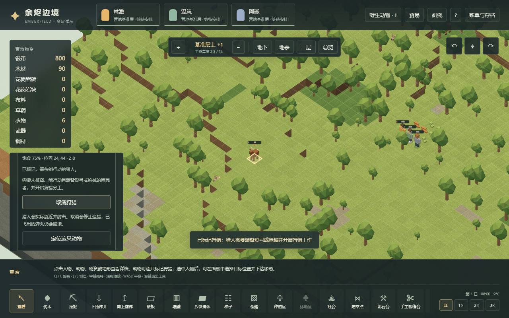

# 体素动物、狩猎与肉食循环（v22）

2026-11-03。本文记录 **Emberfield 已实现的玩法切片**。遵循“先搭机制，再调数值”的开发取向；动物行为和物种参数是本项目的初步设计，未声称精确复刻 RimWorld 动物 AI、身体或生态。参考背景沿用[06 世界生成与资源](06-world-generation-resources.md)、[57 远程战斗](57-ranged-combat-mechanisms.md)、[19 保鲜机制](19-preservation-mechanisms.md)，本轮没有新增原版实机结论。

## 玩家操作

1. 在建筑菜单划定制作点，设置短弓配方。完成后给一名殖民者装备短弓，在分工中开启“狩猎”。也可使用已有枪械。
2. 打开“野生动物”列表，定位并选择鹿或野兔，标记狩猎。地图上的动物也能直接选择；详情显示活动、健康、饱食和执行中的猎人。
3. 猎人寻找有射程和视线的位置，完成瞄准、射击与冷却；目标受伤后逃跑。命中由现有弹丸系统结算，墙、楼板、掩体和沿途人物仍会影响射击。
4. 划定屠宰点，开启厨师工作。厨师实际走到尸体旁取货，再搬到工作面加工；也可先用接受“动物尸体”的仓储集中搬运。
5. 灶台可把肉和植物食材配成简餐，优先使用易腐的肉；殖民者实际取餐进食。肉也可生吃。生肉、尸体和餐食均使用已有室温、冷库与腐坏机制。

## 状态与物资流向

- 动物使用独立的小状态机，不携带人类身体、衣物、技能和护理数据。当前有鹿与野兔，按决定计时继续游荡、觅食、休息；受到命中后远离攻击者，再恢复日常行为。觅食可减少所在格作物的生长量。邻接无路时稍后重新选择，避免一次失败后永久停止。
- 单只猎物只预留给一名猎人。没有远程武器、关闭狩猎分工、取消标记或猎物死亡时释放任务。饥饿、睡眠和护理可中断；标记保留，之后重新分派。不可达目标延后重试，通路恢复后继续。取消不撤回已经发射的弹丸。
- 尸体数量固定为一，保留原动物 ID、物种和腐坏进度，不能合堆。它在动物死亡等待容器、地面、人物携带、屠宰输入之间只有一份归属。没有落地空间时先保留在死亡动物容器中；不会凭空丢掉，也不会无限堆在同格。
- 屠宰点零材料划定，自动加工新鲜动物尸体。暂停会取消任务并退料；没有退料位置时材料保留原任务，直到可安全放置。产出周围满仓时保留已完成进度和尸体，腾出空间再提交一次。
- 烹饪锁定实际配送的肉/植物食材组合；配送后不会替换或刷新年龄。完整材料到位并完成劳动后才生成简餐。
- 原来的冷藏规则适用于地面、随身和已配送的肉/尸体。温度不高于零时停止腐坏，温暖环境继续累积；变质只记一次损失。
- v22 保存动物状态、猎物标记、瞄准/弹丸、尸体身份和加工容器。旧档保留殖民地物资、人物和进度；首次迁移补充可达位置的野生动物，并给原来的全收仓储加入新资源。再次回读不重复补生。

## 暂定参数与边界

物种生命、移动间隔、肉产量、种群上限、重试时间、屠宰工时和动物食品保质期集中在 `src/voxel/wildlife.ts`；它们用于使当前循环可玩，后续可单独平衡。肉的堆叠、营养和初步价值接入现有物流、食物和财富定义。

新局初始八只动物，上限二十四；每两游戏日有一次从可达地图边缘补充一只的机会，直到恢复初始数量。当前是有界的生态补充规则，不是完整的出生、迁徙或承载力模型。

当前尚未实现驯养、训练、围栏、繁殖、捕食/反击、动物身体部位/疾病/出血、皮革副产物、食物中毒和饮食政策。动物健康使用独立生命值；觅食和饱食用于活动选择，尚无饥饿死亡。尸体暂不能买卖或赠送，大宗商队可以收购生肉。冷库沿用现有房间温控；本轮没有改变其原有数值。

## 实际验证

`scripts/voxel-wildlife-campaign-verify.mjs` 从默认种子 73129、tick 0 的普通新局开始，全部建造、制作、装备、分工与狩猎均使用公开游戏命令，未注入动物、装备、肉或尸体。到 tick 5257 完成九项检查：制作并装备短弓、准备期间动物持续移动、真实射击击杀、原动物身份尸体、搬运屠宰、肉做成简餐、实际食用、三名殖民者存活、最终存档保持物资及动物状态。`ready/carcass/meat/meal/final.json` 是该流程产生的中间存档，输出在忽略目录 `test-results/voxel-wildlife/`。

`tests/voxel-wildlife.test.ts` 的十项针对性用例覆盖持续活动、瞄准回读、真实弹丸与唯一尸体、取消、不可达后挖开通路恢复、携带中暂停/回读、混合烹饪、满地面等待后继续、重复身份拒绝、冻结后解冻腐坏、真实 v21 迁移。其中边界用例使用明确的受控场景，不能当作普通经营证据。

真实 v21 起始档 `tests/fixtures/voxel-v21-wildlife-initial.json` 来自此前已接受的 v21 普通贸易经营输出 `test-results/voxel-trade-final/initial.json`，未通过把新存档版本号改小来伪造。旧机制隔离测试排除新增野生动物，以免动物啃食或新的 ID 分配改变原本要单独测的行为；历史存档原始字节保持不变。

本地全量单元测试 **719/719 通过，45 个文件、零跳过**，类型检查和构建通过。浏览器开发服务上 Worker 与 main 渲染各 **13 项通过、零页面/控制台错误**：两种模式都通过可见 UI 标记、真实射击、同 ID 尸体、实际搬运/屠宰、生肉烹饪及导出/导入，另检查动物模型点击、900×700 布局、分工、暂停恢复和仓储筛选。没有注入库存或动物状态。脚本为 `scripts/voxel-wildlife-browser-verify.mjs`；`VOXEL_WILDLIFE_URL` 可指定另一部署地址，`VOXEL_WILDLIFE_BROWSER_OUT` 可隔离保存结果。

所有测试在本地执行；Pages 流水线仍只安装依赖、类型检查、构建和部署。这些是当前机制验收，不代表长期平衡或尚未实现的动物系统已经完成。
