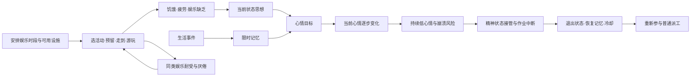

# 71｜心情、娱乐、作息与精神崩溃：从生活安排到失控再恢复

这轮重点是把一个可玩的因果链讲清楚：**生活状态和经历产生思想，思想改变心情目标；安排娱乐时间并提供可用活动，殖民者才能恢复娱乐需求；长期低心情会带来失控风险，失控会打断生产，恢复后重新参与殖民地生活。** 只有一根上下浮动的“心情条”，或点击按钮立即补满心情，都不足以表达这套玩法。

本章为 **RimWorld 1.7.4980 rev60 的静态机制调查**。复用已确认的程序集身份和 ILSpy 提取工具，新增28个类型的局部反编译，结合 Core XML 保留9组结论、21组定义选取。没有重启原版、操作存档或进行新的原生 UI 实验；本章不声称已经实测娱乐时长、精神崩溃概率或完整恢复过程。Web 的最小玩法合同见第7节，其实际实现和验证应另外记录。

## 1. 证据与范围

程序集 SHA256：`eff7d97949f919fb2b151ebfb906e9be749b63410b7dbda78eeebb7972b245c3`。沿用 [REA 身份记录](evidence/artifact-identity.json)，新增 [类型清单](evidence/mood-recreation-types.json)、[反编译清单](evidence/mood-recreation-manifest.json)与[机制证据](evidence/mood-recreation-evidence.json)。证据中的 `MO01` 等 ID 对应结论，`XML01` 等 ID 对应原文件、SHA256、XPath 和所选 XML 原文；C# 引用记录本地派生文件哈希及行号。

本轮按 REA skill v42 的分问题、复用证据、追踪状态变化的流程调查。C# 是由所发售程序集推导的重构结果，不是官方源码；选取的 XML 是安装包定义，不是已经解析所有继承、mod 补丁与 DLC 的运行中 Def 数据库。主要覆盖成年殖民者的普通路径；睡眠和工作派工复用第[14章](14-sleep-housing-mechanisms.md)、第[01章](01-work-and-logistics.md)的局部分析。

| 问题 | 当前结论 | 证据 |
|---|---|---|
| 心情为什么不会随一次事件立刻跳到目标？ | 当前值与思想决定的目标值分开，按需更新时渐进靠近 | MO01 |
| 当前饥饿和昨天的经历是否同一类状态？ | 状态思想重新评估；记忆有年龄、期限、合并与叠加限制 | MO02 |
| 为什么建了娱乐设施仍有人不娱乐？ | 作息、个人能力、类别厌倦、可达性、设施和使用位置都参与 | JO01–JO04 |
| 低心情是否立即失控？ | 持续低于阈值、概率检查和资格检查共同决定 | ME01 |
| 崩溃如何影响实际生产？ | 接管行为，取消普通作业并清理预留、队列和携带物 | ME02 |
| 恢复是否只需把心情加满？ | 状态有自己的退出过程；恢复记忆、冷却和重新派工分别处理 | ME03 |



## 2. 心情是对生活处境的反应，不是娱乐量的别名

`Need_Mood.CurInstantLevel` 先取得思想分组的总心情偏移，殖民者或殖民地囚犯再加入难度偏移，最后与基础心情相加并限制到0–1。健康效果也可以覆盖基础心情。这个结果是**目标值**；`Need_Seeker.NeedInterval` 让当前值逐步靠近它，而不会越过目标。[MO01]

Core 在本版本声明基础值0.32、每游戏小时上升0.12、下降0.08。这些是机制定位用的原版基准，不要求 Web 初版立即照搬平衡。更关键的行为是：改善生活后可以看到“正在变好”，但严重压力不会在设施建成的一刻消失。

Mood 定义设置睡眠时冻结；基类据此停止心情数值的追赶。`Need_Mood.NeedInterval` 随后仍调用思想和记忆更新，不能把“睡眠冻结心情”扩写成“所有心理状态与记忆期限都暂停”。Joy 也设置睡眠时冻结，并额外设置精神状态中冻结；两项需求的冻结配置不同。[MO01；JO01]

### 2.1 当前状态与事件记忆分开

`ThoughtHandler` 持有两个来源：[MO02]

- **Situational**：根据当前条件重新判断是否生效、处于哪个阶段。例如饥饿、疲倦、娱乐缺乏。条件改善后重新评估，不应继续保留为永久惩罚。
- **Memory**：事件留下的独立条目，有 `age`、阶段、可选关联人物和持续时间。到期移除；定义允许时可转换成下一条记忆。重复事件可能刷新已有记忆或受叠加数量上限限制。

因此不要每个逻辑帧添加一条“饥饿−6”记忆；它是同一个当前状态。也不要把一次事件的后果只能存在于当前帧：需要记忆时，应记录起点/年龄与到期规则。

原版先按 `GroupsWith` 合并思想组，再计算组内效果；`stackedEffectMultiplier` 会影响叠加。记忆达到上限时，基础实现可刷新组内最旧记忆的年龄。部分记忆会按定义逐渐淡出，其他记忆在到期前保留效果；不能统一解释成每条记忆线性衰减。[MO02]

### 2.2 娱乐通过思想影响心情

`Need_Joy` 储存娱乐满足程度，`ThoughtWorker_NeedJoy` 再把娱乐类别映射为心情思想：缺乏时是负项，较高时是正项，中间的 `Satisfied` 阶段返回 **Inactive**，不是固定“+5”。Core 中另外两个高阶段的思想才是 +5/+10。[JO01；XML03]

这条转换链使“娱乐恢复了，但人仍不开心”成为合理结果：饥饿、疲倦、伤痛或其他经历仍可能压低目标。初版界面应同时展示娱乐需求、当前心情、心情目标和主要原因，而不是把四者折叠成一条进度条。

## 3. 娱乐的核心是有时间、有条件，并且不能一直重复同一种

### 3.1 娱乐类别、耐受与厌倦

每个活动有 `joyKind`。例如散步/独处属于 `Meditative`，马蹄铁与套石环属于 `Gaming_Dexterity`，棋类属于 `Gaming_Cerebral`。同类设施共享人物对该类别的耐受：多造一座相同设施可以改善接待能力，不会自动增加娱乐种类。[JO01；XML10；XML13]

`GainJoy` 先乘 `1 - tolerance`，再限制到剩余需求空间；耐受随实际获得的娱乐增加。达到厌倦条件后，普通活动选择跳过该类别。耐受会随时间降低，并采用不同的进入/退出阈值，避免临界值反复切换。本版本进入厌倦为耐受大于0.5，退出为小于0.3；这是带回差的状态，不是只看一条即时大小比较。[JO01]

耐受降低速度来自人物当前期望等级。Core 的低期望与高期望定义在这项上不同；因此后期更需要多样娱乐。这里只确认该消费链，未重建财富、身份、思想流派等如何共同选出当前期望等级，也没有把 `joyKindsNeeded` 写成“缺一种就直接扣固定心情”的公式。

### 3.2 选择活动时先检查资格，再尝试可执行的工作

`JobGiver_GetJoy` 排除厌倦类别和人物不能执行的活动，再把耐受作为权重因素选候选；候选不能产生实际作业时，它会尝试其他活动。基础资格还涉及身体能力、是否适合户外活动等。正在医床休养的普通路径不会为了活动随意离床，另有床上娱乐分支。[JO03]

建筑娱乐进一步检查可预留、未禁止、非迷雾、使用资格、可达性等条件；带电力组件的建筑还要求通电。不是场景里出现一个物体，就已经对所有人物提供娱乐。地图“有哪些娱乐种类”的统计也不能替代某个具体人物的作业可执行性检查。

### 3.3 马蹄铁示例：真实行动才产生收益

本版本链条是 `Play_Horseshoes JoyGiver → JoyGiver_WatchBuilding → JobDriver_PlayHorseshoes/JobDriver_WatchBuilding`：[JO03；JO04]

1. 找到可使用的设施和合适的观看/游玩位置，生成包含设施、使用位置和可选座位的作业。
2. 预留设施参与名额与站位/座位；不能让多个角色无条件挤在同一使用格。
3. 普通情况先移动到使用位置，随后朝向设施并执行活动。
4. 活动 tick 根据作业收益率、建筑 `JoyGainFactor` 和类别耐受增加 Joy；有些活动也训练技能。马蹄铁有投掷表现和 Shooting 学习配置。
5. 达到满足、作息改为不允许娱乐、目标消失或作业期限结束等路径使活动结束。通用建筑观看作业的结束回调还会尝试生成娱乐房间印象记忆。

房间印象是另一条思想/记忆来源；不是“只要建筑属于娱乐类，人在地图任何位置都持续获得房间加成”。本轮不扩展完整娱乐室评分、椅子舒适和所有娱乐设施数据库。

## 4. 作息影响竞争优先级，并不是一个绝对动作开关

`Pawn_TimetableTracker` 保存24格小时安排，按当地小时取得当前安排。普通 Core 四种安排与需要选择、工作选择共同作用。[JO02]

| 安排 | 原版普通选择行为 | 玩家需要理解的含义 |
|---|---|---|
| Anything／自由安排 | 娱乐较低时出现娱乐候选；食物、睡眠与工作仍竞争 | 人会处理需求，不是永远工作 |
| Work／工作 | 普通娱乐节点返回0，工作提高优先级 | 排太满会挤掉生活时间；不是消除需求 |
| Joy／娱乐 | 更高满足目标和娱乐优先级；疲劳严重时睡眠仍可胜出 | 安排娱乐不等于强迫无条件游玩 |
| Sleep／睡眠 | 睡眠优先；仍允许较低优先级的娱乐和工作候选 | 没有合适睡眠作业时可能做别的事 |

这里的优先级不是玩家“工作面板1–4档”的同一层级。`MainColonistBehaviorCore` 用 `ThinkNode_PrioritySorter` 比较吃、睡、娱乐、工作等候选，之后工作系统才选择具体生产任务。危急情况、精神状态、征召和上层职责还有更早的行为入口。

初版可以简化为清晰的有限规则，但应保留可解释的抢占和回退：有娱乐时段而没有可用活动时显示阻塞原因；困到需要睡觉时说明为何没有照娱乐表执行。已有工作进行中怎样响应新作息，也需要显式约定，不能只改变新作业选择而让旧娱乐任务永久继续。

## 5. 精神崩溃是持续压力后的行为接管

### 5.1 风险不等于一到阈值立即触发

`MentalBreaker` 读取**当前心情**，分别累计低于不同严重程度阈值的时间；心情回到对应阈值以上时，该累计归零。达到持续条件后才进行概率检查，然后还要通过清醒、未倒地、未处于精神状态、没有禁止因素等资格判断。特质等另有入口，所以“心情引发的崩溃”不等于所有精神状态的产生原因。[ME01]

定位本版本实现所需的少量参数：每150 tick检查，持续低心情超过2000 tick后进入概率分支；恢复后冷却15000 tick，且只在清醒时扣减冷却。原版还有分严重程度的平均发生间隔，**不能把它显示成确定倒计时，或承诺固定时间必定发生**。初版若采用更可控的累计压力触发，必须标明这是 Web 规则。

`RandomFinalStraw` 在已决定尝试崩溃后，从较强负面思想中加权挑选“最后一根稻草”用于原因叙述；它不是严格记录某一个刚发生事件导致阈值越界。Web 可以直接显示当前主要压力来源，避免冒称精确因果追踪。

### 5.2 开始失控时，生产和资源状态一起处理

`TryStartMentalState` 建立精神状态，取消征召、通知相关系统。对于 `stopsJobs` 的状态，它调用 `StopAll`，并处理正在携带的实体。工作清理释放当前作业预留、清掉队列；携带物按规则落到附近。精神状态行为树位于普通派工之前。[ME02]

这意味着初版不能只设置 `workSpeed = 0`：角色若仍持有工作台/材料预留，其他人就可能永远无法接手；携带物若直接清空，会造成物资消失。更合理的合同是“中断人物作业，保留世界中已完成的进度和实物，释放占用，交给专门的失控行为”。恢复后重新检查可用工作，不保证恢复原作业指针。

`Wander_Sad` 提供一个温和的原版参照：其精神状态分支主要游荡，并保留非常低食物/休息条件下的需求候选；它不是无动画站住，也不等于所有失控者都会主动攻击。Web 初版可以采用更安全的寻路边界与生存优先规则，不必复制原版游荡允许的最高危险等级。[XML16–XML20]

## 6. 恢复、宣泄记忆和再次崩溃冷却是三件事

通用 `MentalStateTick` 处理最短时长后的概率恢复、最大时长和强制恢复条件；定义可允许睡眠恢复。`RecoverFromState` 清除精神状态，由心情导致且配置了恢复思想的状态才增加相应记忆，随后通知冷却、清理状态作业并发恢复消息。[ME03]

例如 `Wander_Sad` 配置 `Catharsis`；Core 中这是持续3天、心情偏移+40的记忆，并有叠加限制。它不会直接把当前心情赋为100，也不修好饥饿、疲惫或恶劣环境。原先的生活问题若持续存在，恢复期后仍可能再次陷入风险。

持久化至少涉及当前心情、娱乐、娱乐耐受/厌倦、有效记忆及年龄、精神状态及年龄、低心情累计和恢复冷却。原版分别保存这些字段；只保存“是否失控”会让读档改变风险或丢失恢复进度。原版具体状态并非全部共享相同退出条件，本章只追踪通用路径和悲伤游荡例子。

## 7. v23 建议的最小但连贯玩法合同

以下是**本项目建议**，不是原版一比一规格，也不代表已经完成实现。先做普通建造和作息操作能改变结果的一圈，再逐渐调数值。

| 环节 | 初版必须能看见和操作的行为 | 可暂缓的复杂度 |
|---|---|---|
| 需求与心情 | Joy 独立；当前心情逐步追赶目标；饥饿、疲倦、娱乐缺乏在原因列表中可解释 | 全思想、特质、亲属关系、DLC 精神系统 |
| 娱乐供给 | 一种建造型设施，加一种不依赖设施的独处活动，属于不同类别；走到活动处才恢复 Joy | 电视、棋类、团体聚会、药物娱乐 |
| 时间分配 | 24小时安排至少能在自由、工作、睡眠、娱乐间修改；选中人物能看到当前安排与实际动作 | 多套作息模板和复杂多人自动排程 |
| 类别变化 | 重复同类收益下降；厌倦可恢复；界面说明“没时间／不可达／被占用／已厌倦” | 完整期望等级与财富增长耦合 |
| 风险到失控 | 低心情持续一段时间后预警；首版只实现有明确期限的温和游荡；无法继续正常强制工作 | 暴食、纵火、攻击、逃跑等大量行为分支 |
| 中断与恢复 | 释放预留，正确落下或保留携带物；有恢复消息、短期恢复效果和冷却；重新派工 | 原版所有状态各自的概率、阶段和恢复特例 |
| 读档延续 | 心理状态和时间进度延续；旧档采用明确默认值；不得偷偷改旧实物ID/数量 | 逐值模拟原版所有序列化细节 |

推荐验收用正常操作串起来：排出长工作时段，观察娱乐和心情趋势；建好设施、腾出娱乐时段，看到人物实际前往游玩和原因改善；阻断设施路径后看到可解释的回退；经历一次温和失控和恢复，确认其他殖民者能接手之前被中断的工作。另用定向场景核验临界状态与读档，而不是等待随机概率“碰巧通过”。

不应为了做出负反馈而给所有开局人物塞入大量隐藏惩罚，或强迫玩家在没有任何娱乐恢复途径时必定崩溃。独处活动保留最低限度自救，设施提供更高效率和多样性；排程与建设才会成为有意义的选择。

## 8. 复核方式与未解决边界

在项目目录中，以现有离线提取器重建本轮类型：

```powershell
& scripts/research/extract-rimworld.ps1 `
  -GameRoot 'F:/SteamLibrary/steamapps/common/RimWorld' `
  -DecompilerPath '../../tools/ilspy/lib/netstandard2.0/ICSharpCode.Decompiler.dll' `
  -Group mood-recreation
```

脚本会检查固定的游戏程序集与反编译器哈希；只加载分析库，不执行游戏程序集。证据 JSON 的每个 XML 选择均提供精确 XPath，可对本地原文件重新读取并比较所选节点。已检查本轮类型清单、局部来源哈希和行号边界、所选 XML 与本地原文一致；这些是静态证据一致性检查，不是原版运行重演或 Web 玩法验收。

本轮回答了机制链和最小合同，尚未验证：原版具体人物的实时思想面板、完整一次娱乐/厌倦/恢复的运行轨迹、长时间崩溃发生率、各 DLC 及 mod 的有效覆盖、所有思想来源、完整房间娱乐加成、各特殊精神状态。原先隔离游戏进程已经退出，本轮没有重新启动；因此没有“当前原版仍暂停等待”的状态承诺。
