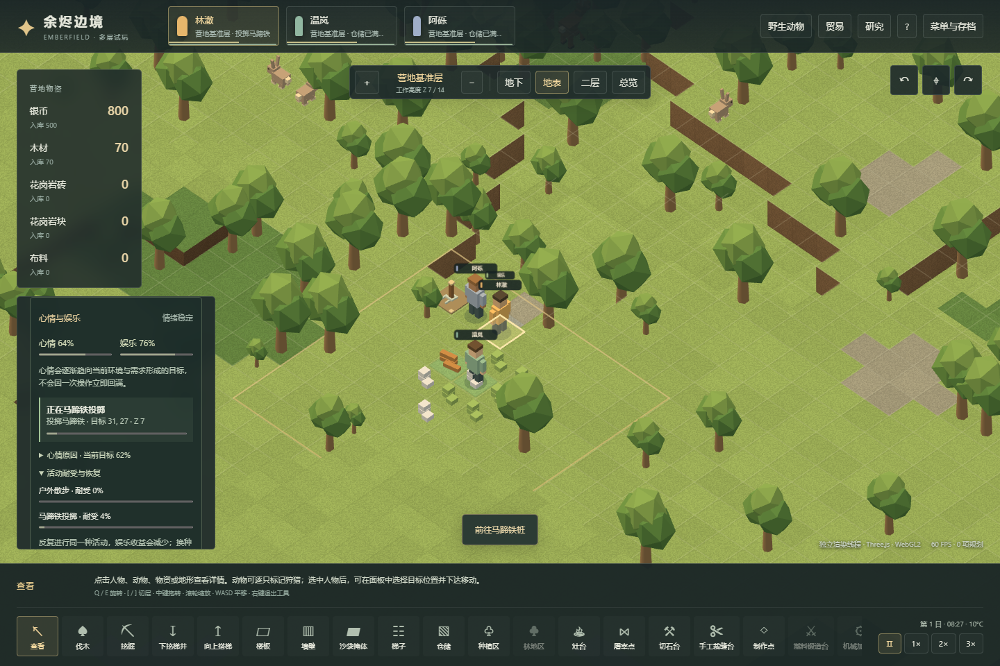

# 72｜体素心情、娱乐与精神崩溃玩法

2026-11-04，存档版本23。重点是生活条件怎样影响人物行动，以及玩家如何干预；参数集中在 `src/voxel/mood.ts` 和 `src/voxel/recreation.ts`，均为可调整的初步平衡。[71章](71-mood-recreation-mechanisms.md)记录原版静态证据，本章记录 Web 实现，两者不能视为已经逐项一致。

## 操作与反馈

选择殖民者可以看到当前心情、心情目标、娱乐满足度和思想明细。饥饿、疲倦、疼痛、不适温度、缺乏娱乐会影响目标；生食和地面睡眠留下会过期的记忆。当前心情逐渐靠近目标，改善条件不会立即补满心情。

在建筑菜单放置马蹄铁桩，工人真实取用20木材并施工。人物实际走到距桩两格的可用位置后才开始投掷和恢复娱乐；一个桩同时接待一人，投掷路径需要净空。没有空闲桩时，可到舒适、可达的户外地点散步观景。室内可以投掷，户外观景需要露天空间。

作息增加“娱乐”选项：自由时段会在娱乐不足时安排活动，娱乐时段使用较高的满足目标，工作和睡眠时段不会自动启动。人物面板也可手动安排或结束娱乐；手动安排可覆盖工作时段，但饥饿、极度疲劳和医疗需求仍可打断活动。改变为工作时段会结束自动活动。拆除或堵住设施后不会继续隔空获得收益。

重复同一种娱乐会提高该类耐受，收益降低；另一类活动和时间可以缓解厌倦。多造马蹄铁桩增加同时接待能力，不增加娱乐种类。当前只有两类娱乐，不含完整娱乐室、棋类、电视和社交活动。

## 低心情到恢复工作

持续低心情会先显示风险，积累到暂定期限后进入“失落游荡”。它会取消征召、释放工作和物流预留、停止普通工作；携带物资尝试放下，空间不足则继续保留，不能因情绪变化消失。崩溃时无法接受移动、换装、战斗、贸易或娱乐等直接命令；分工和作息仍可预先调整。

这是一种有限时长的温和失控行为。恢复后获得暂时的“发泄后的平静”记忆与冷却，再重新找工作。改善食物、床位、温度和娱乐条件可提高心情目标；点击取消或重新征召不会提前清除崩溃。

当前没有狂暴、纵火、暴食、离队等其他精神状态，也没有性格、关系、亲属死亡记忆、房间美观/舒适、期望等级与完整思想数据库。崩溃采用**连续低心情计时后确定触发和定时恢复**，原版的多档阈值、概率与状态特有恢复过程尚未复刻。睡眠时禁止自动娱乐、心情仍渐进变化、崩溃期间娱乐仍可下降、同类娱乐保留最低收益，也是本版明确适配；这些都不是原版数值结论。

## 实物、状态与存档

- 施工、取消施工和拆除复用现有实体材料流程；拆桩返还一半木材，满地时沿用原子放置与等待逻辑。建筑进入财富统计。
- 娱乐状态保存类型、站位、设施身份、开始/结束时刻及是否手动安排。读取后重建路径；设施丢失或路线不通则结束活动重新安排。设施与站位不能重复预留。
- 心情、娱乐、耐受、有限记忆、低落计时、崩溃期限与冷却都随存档保留，回读不能重置期限。
- 接受v1–v23档案；历史v22迁移添加初始心理状态和空娱乐设施列表，保持地形、已有物品/动物身份、物资账本及作息。真实v22样本保存在 `tests/fixtures/voxel-v22-mood-initial.json`，来自上一版本验收输出，未通过降版本伪造。
- 模拟保持20TPS与独立Worker；渲染只消费状态。二维入口仍为原有玩法范围。

## 本地验证

`scripts/voxel-mood-campaign-verify.mjs`从普通种子73129开局，仅用公开命令和推进时间。实际造桩→走到并游玩→途中保存继续→多人竞争设施并改用户外活动→取消活动→正常伐木造三张床→排班娱乐→运行一整游戏日→读取继续。12项检查通过，tick 0→14220，三名殖民者存活且可行动；输出在 `test-results/voxel-mood/`。这证明一条普通经营闭环，不证明长期平衡，也未自然诱发精神崩溃。

`tests/mood.test.ts`检查思想、记忆、耐受、渐变、触发/恢复与非法输入；`tests/voxel-mood.test.ts`检查实体施工、到场前不增益、预留、排班/取消、设施移除、崩溃释放任务与物资守恒、保存恢复以及真实旧档迁移。崩溃测试明确使用受控初值，不作为普通经营或原版实机证据。

本地全套742项测试通过，48个文件，无失败或跳过（`test-results/v23-unit-verified.json`，2个测试worker）。此前并发运行浏览器、构建和4个测试worker时，三个较长的历史模拟用例超过默认5秒期限；减少并发后原断言全部通过，未放宽其验收条件。边界审查修复了无法卸货时错误释放原任务、失去操作能力后仍投掷、以及读档允许娱乐与携货/睡眠冲突的问题；23项心情相关测试均通过。

真实浏览器Worker/main各9项通过，零页面或控制台错误，保留10张截图（`test-results/voxel-mood-browser/report.json`）。覆盖真实造桩、模型点击、排班娱乐/改工作中断、手动开始/结束、到场后娱乐与耐受增长、活动存档往返和900px布局。测试通过只读快照辅助定位与核对，修改全部经可见UI或文件导入；没有使用注入心情的档案，也没有声称观察到自然精神崩溃。

类型检查与生产构建通过，研究便携校验通过798条文档链接。所有测试在本地执行；Pages流水线只安装依赖、类型检查、构建与部署。
