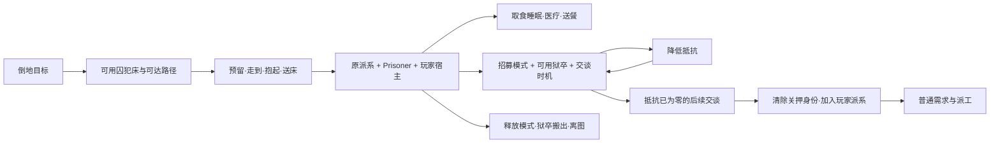

# 73｜俘虏、照料与招募：战斗之后的人口增长链

这轮将人口增长拆成可验证的过程：**准备牢房和囚犯床 → 搬运倒地的人 → 维持生存 → 狱卒交谈降低抵抗 → 后续交谈招募 → 同一个人物加入普通派工**。释放是另一条退出关押状态的路径。俘虏并不是点击后立即变成殖民者，也不是换一种颜色的普通工人。

调查基于 **RimWorld 1.7.4980 rev60**，覆盖普通成年、可招募人类的 Core 路径。静态结论来自本地发行版程序集重构和安装包 XML；原版 UI 观察另存第[74章](74-native-prisoner-runtime.md)，两类证据不混用。本轮不穷举人物类型、DLC、越狱概率或所有关系思想。

## 1. 证据和问题清单

沿用 [REA 身份记录](evidence/artifact-identity.json)，程序集 SHA256 为 `eff7d97949f919fb2b151ebfb906e9be749b63410b7dbda78eeebb7972b245c3`。新增[类型清单](evidence/prisoners-types.json)、[反编译清单](evidence/prisoners-manifest.json)与[机制证据](evidence/prisoners-evidence.json)。证据 ID `PR01` 等记录结论、派生文件 SHA256、行号；`XML01` 等记录原文件哈希、XPath 与选取内容。

采用 REA skill v42 的按问题追踪流程，复用房间、睡眠、食物和人物身份的旧提取。C# 是 ILSpy 的派生重构，不是官方源码；XML 不是已应用所有继承、补丁、DLC 的运行中 Def 数据库。

| 问题 | 结论 | 静态证据 |
|---|---|---|
| 床能否放在露天当囚犯床？ | 需要合格房间；屋顶不是这一资格检查的直接条件 | PR01 |
| 一间房能混放普通床和囚犯床？ | 普通 UI 切换会同步同房间相关床，房间更新也会统一囚犯用途 | PR01 |
| 捕获是否瞬间改变位置？ | 先预留并搬运，送到床后完成普通敌人的关押转换 | PR02 |
| 俘虏是否立即加入玩家派系？ | 普通敌人保留原派系，同时记录玩家为 HostFaction 与 Prisoner 状态 | PR03 |
| 是否必须狱卒每餐手喂？ | 能自理者可自行取食/睡眠；送餐与卧床喂食分开 | PR04 |
| 能否自由开门、娱乐和干活？ | 正常囚犯不能开宿主派系门；无 Joy need；行为树先走囚犯分支 | PR05 |
| 抵抗归零是否还要掷成功率？ | 本版本普通人类路径不再掷一次招募概率，后续有效交谈直接招募 | PR06–PR07 |
| 招募/释放如何退出？ | 招募清 guest 再改派系；释放先解除约束并安排离图，玩家原成员另有留图路径 | PR08–PR09 |

## 2. 牢房是一项空间约束，不是床上的独立标签

`Building_Bed.RoomCanBePrisonCell` 要求 `Room.ProperRoom && !Room.IsHuge`。本版本的 `ProperRoom` 为不接触地图边缘、且包含 Normal district；`IsHuge` 是 `RegionCount > 60`。这里的60是寻路区域数量，**不是60格面积上限**。该路径没有检查 roof count，因此“围合房间”与“必须有屋顶”不能混写。[PR01]

床 UI 在不满足房间要求时禁用“囚犯使用”。在合格房间中，将一张床改为囚犯用途会收集房内其他用途的床一起切换；从囚犯用途切回普通用途也会收集同房囚犯床。`Room.Notify_RoomShapeChanged` 的相关更新还会在合格房间发现囚犯床后，将 `ContainedBeds` 统一为囚犯用途。不能据此把多个卧室只用一道敞口连在一起却当作独立监区。[PR01]

实际找床时还检查是否生成在同地图、能否使用、是否燃烧、占用/归属、医疗用途与关押身份是否匹配等。`RestUtility.CanUseBedNow` 明确排除囚犯身份与 `ForPrisoners` 不一致的床，并要求囚犯床所在位置仍在牢房中。因此开墙使房间失效、改床用途、床被占用，都可能使原本计划不能执行。[PR01]

## 3. 捕获是实际搬运，关押身份不等于玩家派系

普通捕获入口允许征召和未征召的人物，要求搬运相关能力、目标可捕获且能被救援。它按 `GuestStatus.Prisoner` 找可用床，先尊重预留，必要时重试忽略其他预留；仍无床则给出 `NoPrisonerBed` 失败说明。[PR02]

生成的是 `Capture` job，目标为人物和床。`JobDriver_TakeToBed` 预留目标和床、走到目标、抱起、走到床，再调用关押转换并安置入床。普通捕获/救援要求目标仍倒地；床变得不可用、目标消失或携带失败会中断，而不是从点击时就判定“成功入狱”。同派系关押在抱起阶段另有提前转换分支，不能将这个时点套到普通敌人。[PR02]

`CapturedBy` 最终进入 `SetGuestStatus(host, Prisoner)`。它会清理原行为、物品/装备处理、解除征召并通知原 Lord，设置抵抗与意志，更新地图登记和路径缓存。普通敌人不会在这里变为玩家派系：`Faction` 仍是来源派系，`HostFaction` 是关押方，`GuestStatus` 是 Prisoner。曾为奴隶的人另有恢复 `SlaveFaction` 的分支。[PR03]

这种建模同时解释了敌对身份、监区门禁、狱卒服务对象与后续外交。捕获非敌对派系人物还会出现激怒派系的提醒；不能用“救援”替代“捕获”而忽略差异。抵抗 `resistance` 与奴役系统的意志 `will` 是两项状态，**will 不是招募抵抗归零后的第二阶段**。[PR02–PR03]

## 4. 囚犯也会生活，但不参加普通生产

### 4.1 自行取食、睡眠与狱卒照料

Humanlike 行为树在普通殖民者工作之前处理囚犯：逃离/释放离图、就医、穿衣、`GetFood`、`GetRest`、其他需要，以及在当前房间游荡。食物与床仍要通过实际可用性和路径判断；这并不授予穿门去全地图拿饭的权限。[PR04–PR05；XML01]

狱卒分三类实物工作：

- **带回床上**：按当前囚犯、病情、位置与床资格决定是否执行。
- **卧床喂食**：`WardenFeedUtility.ShouldBeFed` 要求殖民地囚犯、已在床上、允许送食，且倒地或需要医疗休息；然后 `FeedPatient` 从实际食物来源取食。
- **送餐**：目标在牢房中、有食物需求且达到饥饿条件，并且不属于卧床喂食对象。若所选食物已在同房，或房内可用营养已满足计算需求，不再生成送餐；否则把一定数量食物送到目标附近。[PR04]

所以“每个囚犯都必须被手喂”“点招募按钮就免于饥饿”均不成立。狱卒本身需要工作资格、预留与可达性，食物也必须存在。Core 的相关 Warden 子项排序为释放100、送床90、喂食80、送餐70、交谈60；这是**同工作类型内部优先级**，不能解释成用户工作表的1–4优先级。[XML04]

### 4.2 门、娱乐与生产边界

正常门的 `PawnCanOpen` 调用 `GenAI.MachinesLike`；后者对 `IsPrisoner && HostFaction == machineFaction` 返回 false。已释放者、特殊 `CanOpenAnyDoor`、门已开启等另有分支。这里确认的是普通门禁，未穷举堵门、越狱、瞬移或所有 DLC 门行为；“囚犯永远无法经过任何门格”会过度概括。[PR05]

Core Joy 定义设置 `neverOnPrisoner=true`，`Pawn_NeedsTracker`据此拒绝该需求。囚犯行为树中出现通用 Joy 节点，并不证明普通囚犯有娱乐条；应把定义资格、组件与行为树一并看。Mood、食物、休息则是不同需求，不因移除 Joy 而一起消失。[PR05；XML01–XML02]

囚犯分支先于普通殖民者工作分支，并以本房游荡/idle 兜底。`workSettings` 被初始化也不等于囚犯正在参加普通生产。实现时需要显式区分“可登记工作设置”与“当前身份有资格进入工作派发”。[PR03；PR05]

## 5. 招募的进展由交谈产生，时机和生活条件共同决定

### 5.1 模式与交谈资格

Core 至少区分 MaintainOnly、AttemptRecruit、ReduceResistance、Release。AttemptRecruit 会先降抵抗；ReduceResistance 在抵抗归零后停止，不自动招募。可招募性还涉及难度的 unwaveringPrisoners、既往殖民者身份和人物类型；本章主链限定为可招募的普通人类，不将不可招募者也承诺最终加入。[PR06；XML03]

交谈需要狱卒可说话、目标清醒、不处于精神状态、能预留和接近；目标若倒地，需已经在床上。`ScheduledForInteraction` 要求距 `lastAssignedInteractTime` **严格超过10000 ticks** 且 `interactionsToday < 2`。计数按人物的当地日 tick 回绕清零，并非每隔固定24小时滑动窗口。[PR06]

一次 ChatWithPrisoner 作业会多次接近并进行 BuildRapport，最后记录交谈时机与次数，再尝试 RecruitAttempt。五段铺垫各声明350 ticks，最终段也声明350 ticks；移动、互动等待、失败跳过都会影响真实耗时，所以不能只用2100 ticks 断言所有实际交谈恰好35秒。抵抗或招募结果在最终互动入口中产生，不是每一个聊天气泡都降一次抵抗。[PR06]

### 5.2 抵抗公式与版本差异

本版本普通人类、没有对应灵感特例时：

`reduction = 1 × NegotiationAbility(warden) × MoodFactor(prisoner) × OpinionFactor(prisoner → warden)`

实际扣减不超过剩余抵抗，并限制到0。MoodFactor 使用囚犯的 **CurInstantLevelPercentage，即心情目标**，不是缓慢追赶中的当前心情条；“低心情”提示的判断却读取当前值 `< 0.4`。这两处数值来源不同。[PR07]

| 因子 | 本版本曲线点 | 含义 |
|---|---|---|
| 心情因子 | `(0, 0.2)、(0.5, 1)、(1, 1.5)` | 改善生活思想可加快降抵抗 |
| 对狱卒好感因子 | `(-100, 0.5)、(0, 1)、(100, 1.5)` | 与谁交谈会影响进展 |
| NegotiationAbility | XML 基础1；Social 因子 `0.4 + 0.075 × level`；最小值0.4 | 最终属性还受说话等能力与其他修饰影响，不能只按技能级别算完 |

初始抵抗来自 pawn kind 范围随机值，可能叠加皇家头衔偏移，再随机取整。例如 Drifter 在本包 Core 中声明 `7~12`；这只是一个种类样本，不能写成所有俘虏统一7–12。[PR03；XML05–XML06]

最容易误复刻的部分是：`InteractionWorker_RecruitAttempt` 将 **AnimalOrWildMan** 与普通人类分开。动物/野人分支有概率试验；普通人类若当前抵抗大于0则降低抵抗，**这次刚降到0也不会同次招募**；下次有效互动进入抵抗已为0的分支后直接 `DoRecruit`。不要在后面再发明“招募进度”或套用旧版本的成功率。Inspired Recruitment 是另一个明确特例，本章未做运行测量。[PR07]

## 6. 招募与释放都是状态转换，不是删除并重建人物

招募调用 `RecruitUtility.Recruit`：解锁服装限制、清除 guest 状态、必要时 `SetFaction` 到招募方、通知被招募。`Pawn.SetFaction` 刷新动态组件和地图登记，初始化工作设置，清理旧行为/预留、更新需求和殖民者栏。它操作同一个 Pawn，不是随机生成一个新人物替换：应保留该人物的技能、伤病等持久身份，重新决定其工作资格与需求。[PR08]

释放模式也要由狱卒实际执行：要求目标不倒地、不处于精神状态且当前可释放，先接近、抱起、搬到释放位置，再 `GenGuest.PrisonerRelease`。`GuestRelease` 解除归属，标记 Released 并停止交互；外来人物安排走向出口。其 guest 清理还涉及实际离图时的 `Pawn.ExitMap` 路径，不能在点“释放”时就把实体凭空删除。[PR09]

原本属于玩家的成员被关押后再释放，存在清 guest 并留在地图的分支；普通外来囚犯释放则不加入殖民地。健康释放相关思想与阵营通知是额外后果，本轮只定位调用，未重建全部外交收益与故事系统。

### 6.1 关押身份与财富口径

`WealthWatcher.ForceRecount` 的人物项遍历玩家派系人物并排除任务旅客；奴隶另乘0.75。普通外来囚犯仍属原派系，因此不在这个人物财富集合中。物品递归的 `WealthItemsFilter` 也拒绝非玩家派系的 Pawn holder，所以囚犯仍穿着、装备或库存中的物品不会经该路径计入；捕获时掉在地上的物品则进入普通地图物品的计数条件。[PR10]

这与原玩家殖民者被关押不同：后者仍可能是玩家派系，不能仅按 `isPrisoner` 将其财富统一清零。人物财富、物品财富与故事系统的人口/威胁点也不是同一口径，本章没有据此推导囚犯对全部袭击计算的影响。

## 7. Web 有限3D版本的最小玩法合同

以下是从机制推导的设计建议，**不是本章已验证的 Web 实现声明**：

1. 床与房间：每张床有用途；有限3D按当前楼层的围合空间判定监区，同房用途同步。屋顶若作为简化要求加入，需明确是 Web 规则而非上述原版判定。
2. 捕获：复用倒地实体和搬运流程，预留目标与空床，途中中断能释放预留并放下人物。入口要显示无床、不可达、无搬运能力等原因。
3. 身份：来源阵营、关押状态、宿主阵营分开保存；囚犯排除普通生产/征召，保留食物、休息、健康与心情。普通囚犯不创建 Joy need。
4. 日常生活：同牢房可自行吃饭、睡觉；不能自行开监区门外出取食。狱卒从实际库存送餐或为卧床者喂食，仍受距离、库存和预留约束。
5. 交谈：模式至少包括照料、招募、仅降抵抗、释放；狱卒走到目标后进行一段有时长、可中断的交谈。结束时才改变抵抗/身份，不在指令发出时结算。
6. 招募：保留一项抵抗。归零后下一次完整有效交谈加入；接入现有殖民者列表、工作、作息、征召、睡眠与需求系统，并保留原技能和伤病。
7. 释放：需要搬出/放行过程与地图出口，外来囚犯离图；不要将释放写成增长人口的另一按钮。
8. 存档：至少持久化人物身份、床用途/归属、抵抗、交谈模式/时机、携带与预留。加载时取消不可恢复的旧作业并清理预留，避免复制人物、永久携带或幽灵占床。

## 8. 未完成的边界

静态主链已回答；完整自然战斗捕获到招募的长时运行、交谈耗时分布、不同生活条件的招募天数、越狱与门被堵时的所有例外、DLC 奴役/意识形态/血源与未成年路径仍未验证。运行报告只应按实际截图、输入记录与存档说明观察到哪一步，不能用本章代码结论替代原生执行证据。
