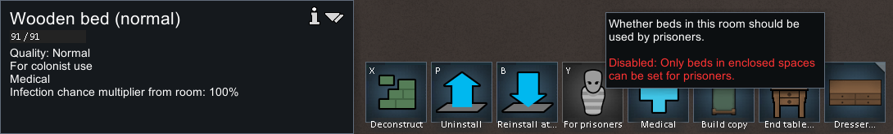
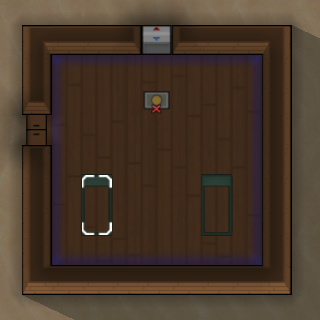
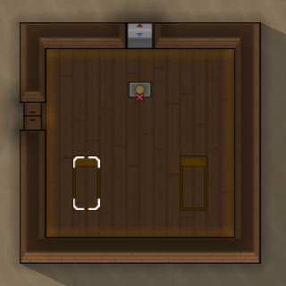
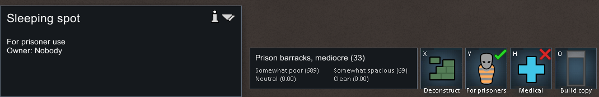

# 74｜原版囚犯床运行观察：室外限制与同房用途同步

本轮原生运行验证了两项界面行为：**室外床不能切换为囚犯用途；同一房间中只切换一处睡眠点，另一处也会同步切换。** 最终由原版写出的存档保存了两个 `forOwnerType=Prisoner` 的睡眠点。完整捕获、喂食、交谈、招募与释放仍属于第[73章](73-prisoner-recruitment-mechanisms.md)的静态追踪范围，本章不声称已运行验证。

## 1. 目标、隔离和证据

日期：2026-11-04（Asia/Shanghai）。运行 RimWorld **1.7.4980 rev60**，独立 profile 为 `.local-research/runtime/profile-prisoners-20261104`，通过 `-savedatafolder` 选择；Core + Odyssey，未启用其他 mod。启动时 PID 为26176；完成后用普通 `Quit to OS` 退出，CIM 查询确认不再存在 `RimWorld.exe`。

基线从旧研究 profile 的 `trade-buy-verified-b.rws` 原样复制为 `prisoner-baseline.rws`，二者 SHA256 相同：`417a7846d88bba8b8001b5d62dec206bc601d2c554185bc5004bd285fd75be82`。没有载入用户普通 profile 或改写其存档。

输入使用[专用窗口脚本](../../../scripts/research/prisoner-runtime-input.ps1)，每次校验 PID、可执行文件、profile 命令行、前台窗口和客户区边界。仅发送普通鼠标/键盘输入，没有注入游戏代码或修改存档 XML。继承的 Config 开启开发者模式，但本轮没有调用开发者生成、即时招募或修改数值。

证据包：[prisoners-runtime-evidence.json](evidence/prisoners-runtime-evidence.json)，保留26条输入记录摘要、四张局部截图、原始截图 SHA256、裁剪坐标、原版存档 SHA256 与床 XML 摘录。原始全图和存档只在忽略目录中保留。公开裁图用于说明机制，不作为 Web 游戏素材。

## 2. 室外床被拒绝切换

选择已有的室外医床，在普通界面点击 `For prisoners`。游戏保持其 `For colonist use`，并显示：

> Disabled: Only beds in enclosed spaces can be set for prisoners.

对应原始动作009和 `PRR01`。这证明本场景室外床被拒绝；没有通过该画面测量房间大小上限，也没有测试“围墙完整但无屋顶”的房间。屋顶不是资格检查的直接条件来自静态 `PR01`，不是本图的运行结论。

## 3. 同房两个睡眠点同步切换

通过 Architect → Furniture → Sleeping spot，在已有围合房间内放置两个睡眠点；不需要材料加工。取消建造选择后，第一处面板显示 `For colonist use`，房间显示 Barracks。

| 切换前 | 只切换第一处之后 |
|---|---|
|  |  |

动作019只点击所选第一处的 `For prisoners`；两处随即变为黄色。动作020再单独选择第二处，其面板同样显示 `For prisoner use`，房间角色为 `Prison barracks`：

此步骤没有逐张手动切换，因此支持“房间用途同步”，而不只是“两张床都能分别切换”。从囚犯切回普通用途、房间打通后重算、床已被别人拥有时的警告确认，仍只保留静态结论。

## 4. 原版存档核对与过程偏差

最终成功写出的实际文件是 `.local-research/runtime/profile-prisoners-20261104/Saves/New Arrivals1.rws`，SHA256 为 `ce0620ce2809fa582014cbbbe2302703d828585ebdb97f6260958fc65d88dc0d`。计划输入的 `prisoner-room-verified` 没有替换默认名称；检查文件与保存提示后，以实际名称记证据，没有将不存在的计划路径当成功结果。

读取原版 XML 的选择路径：`//maps/li/things/thing[def="SleepingSpot" or def="Bed"]`。

| 原版对象 ID | 位置 | 存档结果 |
|---|---|---|
| `SleepingSpot150535` | `(102, 0, 139)` | `forOwnerType=Prisoner`，`spawnedTick=203135` |
| `SleepingSpot150536` | `(106, 0, 139)` | `forOwnerType=Prisoner`，`spawnedTick=203135` |
| `Bed77946` | `(113, 0, 124)` | 保留医床；`forOwnerType` 字段未序列化，界面仍为普通殖民者用途 |

基线 `ticksGame=189222`，最终 `ticksGame=203135`，相差 **13913 ticks**。最初在加载画面发送速度/暂停键，不能据此声称已经暂停；后续看到地图仍运行，才显式选择一倍速并点暂停。此后的房间操作在暂停画面完成；两个新睡眠点的生成 tick 与最终存档 tick 一致，但本轮没有做两份相同 tick 的存档对照，因此不把它写成完整暂停持久性测试。

## 5. 结束状态和可复用性

成功保存后，从已观察到的菜单点击 `Quit to OS`。目标退出导致截图保护拒绝保存动作027的截图（`Focus changed; skip potentially unrelated screenshot`）；没有将无关桌面截为游戏证据，也没有声称这张截图存在。随后查询确认没有 RimWorld 进程。

[只读证据收集脚本](../../../scripts/research/collect-native-prisoner-runtime.ps1)可从已保留的原版全图、输入日志和存档重新生成证据包/裁图，校验最终有两处囚犯睡眠点，并检查研究进程已退出。它不启动游戏、不操纵窗口、不修改原版存档。

当前结论边界：

- **运行已观察**：室外床用途拒绝、室内普通睡眠点、单处切换引发同房同步、另一处独立面板状态、原版存档持久化。
- **仅静态追踪**：捕获搬运、囚犯身份和门禁、送餐/喂食、抵抗与招募、释放、财富计算。
- **仍未测量**：自然战斗后完整捕获到招募、实际交谈耗时/频率、长期照料成本、不同心情/好感的招募天数、越狱与 DLC 变体。

Web 的对应验证应使用自己的回归和浏览器测试报告；这份原版记录不能代替 Web 实现证据。
