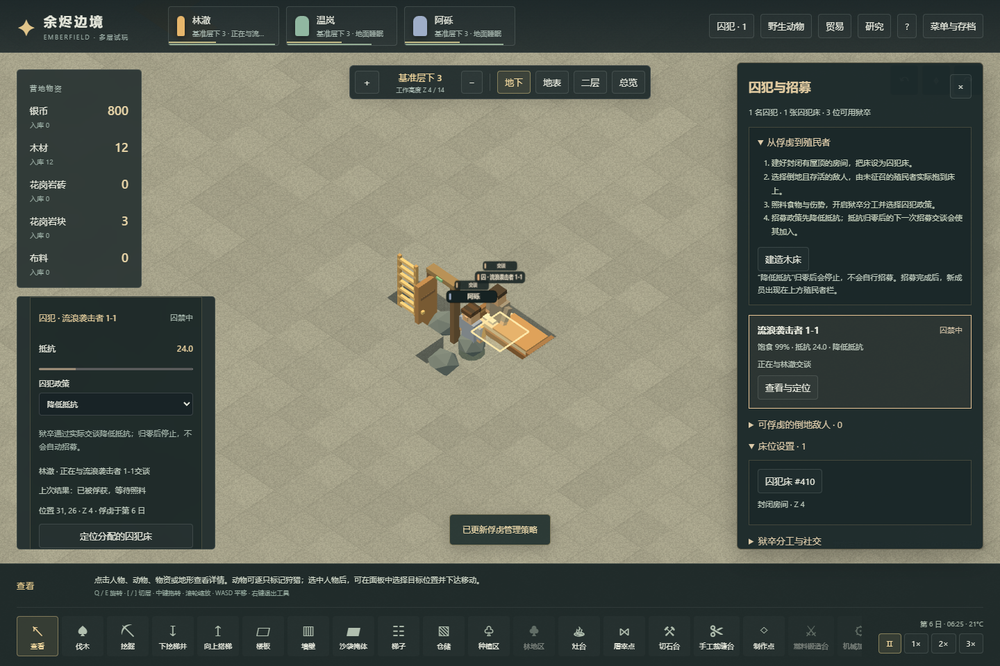

# 75｜体素俘虏、照护与招募玩法

2026-11-04，存档版本24。本轮优先打通战斗→住房→医疗→社会交谈→新增人口的实际流程。参数集中在 `src/voxel/prisoners.ts`，用于首轮试玩，尚未做长期平衡或原版逐项拟合。[73原版规则](73-prisoner-recruitment-mechanisms.md)、[74原版实机](74-native-prisoner-runtime.md)与本章的 Web 验证分开记录。

## 玩家操作

1. 在封闭、有屋顶的房间里建床，选择床并开启“囚犯床”。同一封闭房间的床会一起切换用途；医疗用途可同时开启。普通殖民者不会认领囚犯床。
2. 战斗结束后，选择仍活着的倒地袭击者，选一个未征召、能够搬运的殖民者执行俘获。执行者必须先走到身边，再把目标实际抱过地面、楼梯和门，送到空闲囚犯床。
3. 在俘虏面板设置医疗政策。医护会实际取草药、到场护理；伤口与营养不良需要继续恢复。囚犯能在牢房内寻找并吃掉真实食物，疲劳或病情需要时回本人床休息；没有可达食物时回床等待送餐。
4. 在分工中启用“看守”，在俘虏面板选择仅照料、降低抵抗、尝试招募或释放。看守到身边完成交谈才结算抵抗变化，双方的交谈/听力能力、囚犯健康和交谈冷却参与条件判断。
5. **抵抗归零不立即入队。** 招募策略在下一次符合条件的完整交谈后让原人物加入殖民地；“降低抵抗”策略到零就停止。没有第二条招募进度条。
6. 选择释放后，看守先到场释放，囚犯解除床位占用并实际走到地图边缘。通路被锁住时留在地图等待，不会瞬间消失。

俘虏抽屉可查看人物、床位、伤情、抵抗、管理策略、最近交谈和等待原因，并定位相关人物。健康、倒地和正在搬运的人物都有可选入口；招募后原人物出现在殖民者头像栏，接受正常分工与征召。

## 状态、中断与实物

`prisonWorld.ts` 负责捕获、看守和囚犯的行为，世界统一推进位移、门、伤病和食物消耗。普通房间内行走的寻路搜索本身限制在牢房连通区域，不允许先找到穿出牢房的捷径后沿用。囚犯不会自动开门外出或参加殖民者劳动；获释后的离图另有权限。

床位与目标都有独占预约，搬运和护理/交谈不能同时占用同一人物。征召执行者、失去操作能力、道路阻断、床撤销、患者死亡等会释放任务；搬运中断时人留在执行者实际位置，看守可再次搬运到合法空床。卸货失败保留原工作与实物。撤销囚犯床会清理床引用，让囚犯等待转移。

原版保留人物原派系并用 guest status 表示囚犯。本项目以 `faction='prisoner'` 分流行为，并保存 `prisoner.originalFaction='raider'`，这是内部结构适配。捕获时主武器实际落地，附近放不下则保留待放下的原武器，不能复制或销毁。原来已发射的弹丸继续保留发射时阵营。

招募复用同一人物 ID，保留技能、伤口、缺失部位和现有物品。新殖民者才建立普通心理与工作设置。人数不再硬编码为3；仍有64个人物及遗体的地图总容量。外来囚犯本体与随身装备不计入殖民地财富，落地装备按普通地面物资计入；加入后按殖民者估值。

## 存档与明确简化

存档升级24，接受历史v1–v23。旧档不补发俘虏、食物或人口，只增加空状态、床用途和看守优先级；历史实际样本 `tests/fixtures/voxel-v23-prison-initial.json` 保留原始字节。床、双方搬运关系、正在交谈的进度、抵抗和下次交谈时刻都保存，回读不跳过冷却。非法身份、重复床位、重复目标、虚构双方搬运关系及冲突活动会被拒绝。

首版的边界是：

- 原版 `ProperRoom` 不直接要求屋顶；本项目六向体素封闭房间会同时要求屋顶。暂未做独立的无屋顶围墙牢房分类。原版室外床直接禁止切换用途，本版允许先标记床用途，但房间不合格时不能执行捕获搬入。
- 原版健康囚犯通常接受送餐后自己进食，卧床患者才由医护喂食。本项目复用现有实体取餐/运输/喂食：健康且饥饿、没有室内食物的囚犯回本人床等待送餐，也可被直接喂食。实际食物仍从地面取用，不是无限补给。
- 原版囚犯没有 Joy 需求。本项目不调度其娱乐，也不对其执行殖民者低娱乐惩罚/精神崩溃；心理容器作为兼容状态保留，完整囚犯思想与情绪行为还未接入。
- 当前只俘获倒地的普通袭击者。奴役、逮捕己方人员、不可招募身份、越狱、监狱暴动、关系/观点评估、信仰转化、处决与交易人口尚未实现。
- 仅实现普通招募的主要流程；具体抵抗、交谈效率与时间为暂定参数，不声称已复刻全部原版概率与修正项。

## 验证入口

`npm run test:voxel:prisoners` 从新的温带平地种子73129开始，仅使用公开命令、时间推进与保存/读取。实际开凿三层梯井与六格地下牢房、用实物造门和床，等待普通叙事袭击，再实际战斗击倒、俘获、照料、交谈及招募。18项检查通过，最后4名殖民者均存活且可行动。第一次抵抗归零时仍为囚犯，下一次完整交谈才入队。产物、运行代码与检查点哈希保存在 `test-results/voxel-prisoners/report.json`；这证明一条普通可玩流程，不是招募速度或战斗胜率实验。

`tests/prisoners.test.ts`、`prison-world.test.ts`、`prison-persistence.test.ts` 与 `voxel-prison-integration.test.ts` 覆盖状态转换、独占预约、实际位移与资源、取消/转移、伤病、释放、死亡、旧档及弹丸身份。受控伤情样本只用于边界测试，不冒充普通游戏或原版运行。

最终本地全套779项测试通过，52个文件，无失败或跳过（`test-results/v24-unit-final.json`，2个测试worker）；其中本轮37项囚犯相关测试，18项是实际世界集成。审查另修复了暂停时撤销床位遗留交谈预约、护理与睡眠床用途验证不一致、病囚取药期间丢失卧床状态，以及同tick受伤后残留交谈预约和睡眠战斗姿态。生产构建通过，研究便携检查通过817条文档链接。

`npm run test:voxel:prisoners:browser` 从正常流程检查点经可见界面导入，在 Worker/main 两条渲染路径验证床位、俘获、照料面板、真实交谈、存档和招募。只读快照用于定位和断言，状态修改经界面和合法存档导入。

最终生产构建页面验证 Worker/main 各9项通过，均无页面或控制台错误，实际加载的JS/CSS字节与本地构建一致（`test-results/voxel-prisoners-browser-build/report.json`）。其中“降低抵抗”在归零并跨过交谈冷却后仍不会招募；改为“尝试招募”后完成下一次交谈才入队。另实测释放后步行离图、途中存档及900px四人头像/抽屉布局。

所有测试在本地执行。Pages工作流只安装依赖、类型检查、构建和部署。
