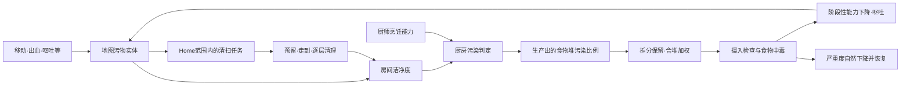

# 76｜卫生、清扫与食物中毒：空间管理如何影响生产和健康

卫生系统的主链是：**人物移动或事件留下污物 → 房间洁净度改变 → 烹饪批次可能污染 → 食物拆分、合堆保留污染状态 → 吃下后发病 → 呕吐和能力下降造成新的工作负担**。家园区决定清扫范围，房间边界决定厨房环境统计范围，食物堆决定污染状态的传播范围；这三个范围不能合成一个全局卫生数值。

本轮研究 **RimWorld 1.7.4980 rev60** 的 Core 路径。原版清扫操作见[第77章](77-native-sanitation-runtime.md)；本章的厨房概率、病程和容量影响来自静态重构与发行版 XML，未做原版概率采样。

## 1. 证据范围

沿用 [REA 身份记录](evidence/artifact-identity.json)，程序集 SHA256 为 `eff7d97949f919fb2b151ebfb906e9be749b63410b7dbda78eeebb7972b245c3`。新增[13个类型清单](evidence/hygiene-types.json)、[提取清单](evidence/hygiene-manifest.json)、[10条机制证据及10组XML选取](evidence/hygiene-evidence.json)。每条 `HY` 记录派生文件哈希和行号，每条 `XML` 记录安装包文件哈希、XPath 和选中节点。

采用 REA skill v42 的机制追踪方法，复用此前提取的 Room、GenRecipe、FoodUtility 和 Hediff。ILSpy C# 是发行程序集的派生重构，不是官方源码；选取的 XML 也不是已经应用全部继承、DLC 与补丁的运行中 Def 数据库。

| 问题 | 本轮确认 | 证据 |
|---|---|---|
| 污物是否按全图定时增长？ | 移动拾取、携带、掉落、自产及事件生成是不同入口 | HY01 |
| 洁净度是否等于污物层数之和？ | 聚合使用实体 `stackCount × Cleanliness`；没有直接乘 `Filth.thickness` | HY02 |
| 户外厨房是否平均全地图血迹？ | 普通开放户外不计算 Room stats，返回 roomlessScore | HY03 |
| 强制清扫能绕过家园区吗？ | 普通 CleanFilth 资格检查仍要求 Home | HY04 |
| ×4餐是否分别掷四次污染？ | 一个 products 条目生成一堆，调用一次生产通知 | HY05 |
| 污染饭与正常饭堆叠后怎样？ | 按实际吸收份数加权，拆分继承污染比例 | HY06 |
| 中毒是否持续固定强度？ | 初期、严重、恢复三阶段；严重度自然下降 | HY07 |
| 再吃污染饭是否再叠一层病？ | 复用同一疾病，非初期回到严重阶段起点附近 | HY08 |
| 呕吐只是动画吗？ | 打断当前工作、停止移动、生成污物并可能损失饱食度 | HY09 |
| 所有食物中毒都来自厨房吗？ | 危险食物类型另有摄入检查 | HY10 |

## 2. 污物是地图对象，来源与层数要分开

`Pawn_FilthTracker.Notify_EnteredNewCell` 在人物进入新格时处理携带污物。飞行人物直接返回；普通路径分别有5%尝试掉落、10%尝试拾取，再以 `FilthRate × 0.005` 判断自产污物。这里都是**每次进入格子的检查**，不是每秒全地图统一增加的概率。[HY01]

人类自产污物时，已知上一个地形污物类型会以66%机会使用它，否则使用垃圾；昆虫与其他动物有各自污物类型。拾取会读取地形的 generatedFilth 和格内可附着污物，掉落则经过地形与来源标记的准入判断。新污物不能当然地出现在任何表面：`FilthMaker` 检查地形 placement mask、FilthMultiplier 和可行走等条件。同格同类型污物通常加厚，不能继续加厚或位置不合适时还可能寻找邻格。[HY01]

`Filth` 持有独立的 `thickness`、`growTick`、消失时间及来源描述。`CanBeThickened` 的普通入口阈值是5层；附着到脚上要求配置允许、厚度大于1且距 growTick 超过400 ticks。减少到0层才销毁实体。不同来源和消失机制未在本轮逐项穷举。[HY01]

核心定义给出的几个例子如下。数值是实体的属性；“每层清扫工作量”与“房间洁净度贡献”不是同一个量。[XML01]

| 污物 | Cleanliness | 每层清扫工作量 | 与设计有关的区别 |
|---|---:|---:|---|
| 泥土 Dirt | -5，继承 BaseFilth | 35 | 可以由脚上携带的地形污物带入 |
| 血 Blood | -10 | 70 | 伤病/战斗可留下更重的卫生负担 |
| 呕吐物 Vomit | -15 | 70 | 中毒可能继续污染工作与生活空间 |

## 3. 洁净度在房间内聚合，户外有单独回退

`RoomStatWorker_Cleanliness` 取 `ContainedAndAdjacentThings`，仅累计 Building、Item、Filth、Plant 类别的 `stackCount × Cleanliness`，再加上每个房间格子的地形洁净度，最后除以 `room.CellCount`。[HY02]

因此，地板、具有卫生属性的设备和污物共同决定房间得分。房间面积会稀释同一实体的贡献；边界相邻物体是否进入该列表取决于 Room 收集逻辑，不能简化成只看灶台所在一格。此聚合代码**没有显式乘污物的 thickness**；Filth 本身也未在该类中覆盖这项 Stat。层数明确影响的是清扫工作量。实现时若自行让污物层数线性放大洁净惩罚，应注明这是 Web 规则。[HY02]

`Room.GetStat` 并非一定执行上述平均。只有 `ProperRoom && RegionCount <= 60` 才保留 stats；否则 stats 为 null，直接返回对应 RoomStatDef 的 roomlessScore。ProperRoom 要求不接触地图边缘且包含 Normal district。普通开放户外因此使用 **厨房风险回退2%**，不是整张地图血迹平均值；这里的60是 Region 数量，不是60格面积。该资格分支没有直接以屋顶覆盖判断，封闭但未盖屋顶的小院不能简单等同于开放户外。[HY03]

房间厨房污染曲线为：

| 房间洁净度 | 厨房污染检查概率 |
|---:|---:|
| -5 | 5% |
| -3.5 | 2.5% |
| -2 | 0% |

这些点交给曲线求值。UI 上的 very dirty、dirty、slightly dirty、clean、sterile 标签使用另一套阈值：dirty 从-1.1开始、slightly dirty 从-0.4开始、clean 从-0.05开始、sterile 从0.4开始。因此看见“dirty”文字，不等于已经产生额外厨房中毒概率；要区分展示等级与实际曲线。[HY03、XML02]

## 4. 家园区是清扫任务的范围约束

全局候选来自 `ListerFilthInHomeArea`。`HasJobOnThing` 对普通与 forced 命令都要求目标格属于 Home，并排除迷雾、不可预留目标，以及距离上次加厚不足600 ticks的污物。候选登记会随污物生成、销毁和家园区变更更新。[HY04]

找到目标后，Clean job 可以收集同房间及相接门区域的附近污物组成队列。人物需要预留目标、走到 Touch 范围，再开始清理；行走与清扫时均重新检查 Home，目标移出家园区会被跳过。[HY04]

工作积累大致为 `CleaningSpeed × delta / 地形CleaningTimeFactor`；地形因子为0时该分支不做除法。累计工作**大于**该污物每层所需工作量后减一层、重置这一层工作。只有实体完全消失才转向下一项并记一次 MessesCleaned。不会点击一次就清空整间房，也不能因为画面少了一片污物就反推出精确工作速度。[HY04]

这种机制使“划很大的家园区”具有劳动成本；只想维护厨房和主通道时，范围工具本身就是经营手段。第77章用普通 UI 扩展一个家园区格子，随后执行了一次真实清扫，验证的是这条操作链。

## 5. 污染先发生在生产批次，再在摄入时发病

### 5.1 厨房检查与厨师检查有先后关系

`CompFoodPoisonable.Notify_RecipeProduced(pawn)` 使用**厨师当前所在 Room** 的 FoodPoisonChance。厨房检查成功则记录 FilthyKitchen；仅在失败后再按厨师的 FoodPoisonChance Stat 检查，成功记录 IncompetentCook。任何一个成功都会把该产物堆的 `poisonPct` 设为1。[HY05]

设厨房概率为 `pK`、厨师概率为 `pC`，这条顺序分支对应总污染概率 `pK + (1 - pK) × pC`，不能直接相加。干净房间消除环境项后，低技能厨师仍可能污染食物。

Core 的 Cooking 技能直接值前10项如下；它们属于**生产污染检查的输入**，不是某位食客吃这一顿后的最终中毒概率。[XML06]

| Cooking等级 | 0 | 1 | 2 | 3 | 4 | 5 | 6 | 7 | 8 | 9 |
|---|---:|---:|---:|---:|---:|---:|---:|---:|---:|---:|
| 直接值 | 5% | 4% | 3% | 2% | 1.5% | 1% | 0.5% | 0.25% | 0.15% | 0.1% |

`GenRecipe.MakeRecipeProducts` 对每个 products 条目创建一个 Thing，设置 stackCount 后只调用一次生产通知。普通简餐配方的产物是1份，批量简餐配方的同一产物条目是4份。因此这条普通批量路径的一次污染检查影响整堆4份；它不是四个独立生产污染样本。[HY05、XML07–XML08]

### 5.2 拆分、合堆和摄入

`poisonPct` 与原因会序列化。拆出一份时复制相同比例与原因。合堆时使用目标旧份数与**实际吸收份数**做加权：

`新比例 = (旧比例 × 旧份数 + 来源比例 × 吸收份数) / (旧份数 + 吸收份数)`

例如4份污染饭与6份正常饭全部合并后比例为0.4。此后拆出的每份继承0.4；代码并不保留“前四份是坏饭”的逐份标签。合堆原因按有无已知原因及污染质量占比选择，比例计算独立于原因文本。[HY06]

吃下食物时才按 `poisonPct × GetFoodPoisonChanceFactor(食客)` 检查发病。食客因子包含故事讲述者难度、健康阶段因子和适用的基因/DLC分支。因而污染比例1也不能在脱离难度与食客条件时声称“必定发病”。危险食物类型还通过 `FoodPoisonChanceFixedHuman` 或特质覆盖走另一条摄入检查，不能将所有中毒都归因于脏厨房。[HY06、HY10]

## 6. 三阶段病程、再次摄入和治疗边界

FoodPoisoning 的初始严重度是1，每日变化-1；严重度更新组件以200 ticks的哈希间隔应用变化，降到0或以下后满足移除条件。普通 Core 定义推导出约一个游戏日自然恢复，精确消失时刻未做实机测量。[HY07、XML09]

| 时间顺序 | 严重度区间 | 疼痛增加 | Consciousness | Moving | Manipulation | Eating | 呕吐MTB |
|---|---|---:|---:|---:|---:|---:|---:|
| initial 初期 | ≥0.8 | +0.2 | ×0.6 | ×0.8 | ×0.9 | ×0.5 | 0.3天 |
| major 严重 | ≥0.2且<0.8 | +0.4 | ×0.5 | ×0.5 | ×0.8 | ×0.3 | 0.2天 |
| recovering 恢复 | <0.2且尚未移除 | +0.2 | ×0.6 | ×0.8 | ×0.9 | ×0.5 | 0.4天 |

这些是身体能力的 **postFactor**，不等于最终移动速度或生产速度直接乘表中系数。血液过滤还分别为×0.95/×0.85/×0.95；严重期 Talking 为×0.8。MTB 是随机事件的平均间隔参数，不是每隔固定分钟必吐一次。[XML09]

再次触发中毒时，`AddFoodPoisoningHediff` 先找已有疾病：

- 已处于 initial：不重设严重度。
- 已处于 major 或 recovering：把严重度设为 `0.8 - 0.001 = 0.799`，回到严重阶段起点附近。
- 尚无疾病：添加新的 FoodPoisoning。

因此不会叠加第二份相同疾病，也不会在每次摄入时都重置为完整初期；连续吃污染存粮可以拖延恢复。[HY08]

Core 的 DiseaseBase 与 FoodPoisoning 定义都没有开启 tendable，HediffDef 中该布尔字段默认 false，而 TendableNow 首先拒绝不可治疗定义。**普通医生照料或消耗药物不是这项食物中毒的治愈工作**；它走自然严重度下降，也不要求先累积免疫。人物同时存在的伤口或其他疾病仍可能需要医疗，不应由此取消其他照料。[HY07]

## 7. 呕吐将疾病反馈到卫生和劳动

Hediff 以600 ticks的哈希间隔根据阶段 MTB 判断呕吐事件，还要求人物已在地图、清醒且是肉体生物。触发后强制打断当前 job，并请求之后恢复原工作。[HY09]

`JobDriver_Vomit` 的初始化使用 `Rand.Range(300, 900)` 设置持续 ticks，停止移动并选附近落点；每150 ticks哈希检查生成呕吐污物。若 Food need 高于最大值10%，会扣除最大值4%。它不是按餐数返还食物，也不是每次呕吐必然把饱食度清空。结束后原工作能否继续还取决于目标是否仍有效。[HY09]

这构成实际经营反馈：污染食物使工人变慢并中断工作，呕吐新增污物，清扫又需要时间；饥饿者还可能再次取食污染储备。将中毒实现为一个只降低生命值的图标，会丢失这条因果链。

## 8. Web复刻应保留的结构与可简化之处

优先保留地图污物、Home清扫范围、房间洁净度、厨师所在房间风险、食物堆污染比例、三阶段疾病和重复摄入规则。清扫应成为可预留、可行走、可中断的普通工作；发生中毒后让需求和生产系统继续受影响。

第一版可以减少污物类型、忽略脚上携带细节、缩短病程，并只保留少量能力惩罚，但须注明是 Web节奏调整。使用种子化随机流、人物ID与tick构造可复现检查也是 Web设计选择；本轮原版代码没有证明存在该特定随机公式。已确认的 Core病程也不支持将“半天统一debuff”描述成原版机制。

建议分别验证三个小闭环：Home内实际清扫改变地图实体；一次批量生产污染能够经过拆分/合堆进入摄入检查；同一病人再次摄入时回到major而不叠疾病。本轮原版仅验证第一项，其余来自静态证据；Web测试证明的是 Web实现，不替代原版实机证据。

## 9. 复核入口

- [静态机制证据](evidence/hygiene-evidence.json)与[原版实机证据](evidence/hygiene-runtime-evidence.json)。
- [静态证据采集器](../../../scripts/research/collect-sanitation-evidence.ps1)读取本机提取与安装包；[实机证据采集器](../../../scripts/research/collect-native-sanitation-runtime.ps1)只读取已经生成的隔离存档和截图。
- [便携验证器](../../../scripts/research/verify-sanitation-evidence.mjs)可在不安装游戏时检查已提交记录与截图哈希；加 `--local` 检查本机派生源码、原始截图及存档哈希。

尚未做原版厨房污染频率、批次混合实测、房间洁净度变化、自然病程、医疗菜单对照和精确清扫速度测量；不把静态概率或单次清扫结果写成上述测量结论。
