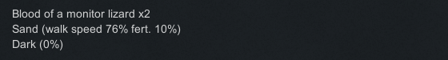
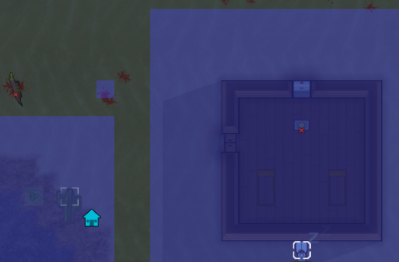
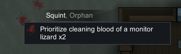
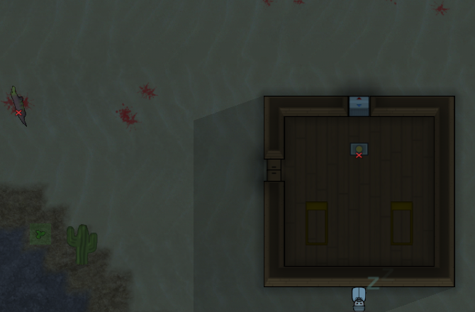
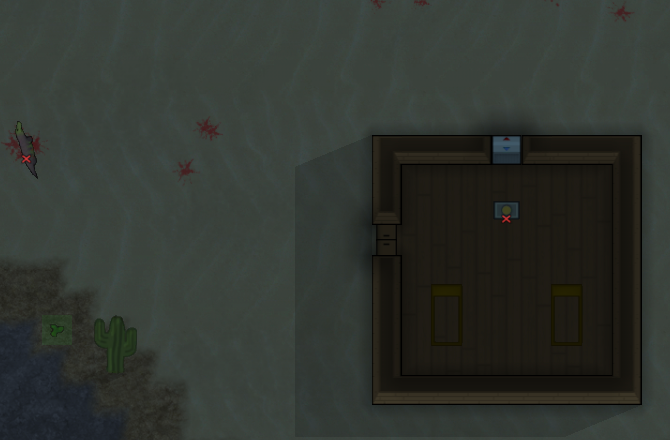

# 77｜原版实机：把血迹纳入家园区并完成一次清扫

本次在原版 **RimWorld 1.7.4980 rev60** 中，通过普通区域与人物命令 UI，将一格已有血迹加入家园区，指派 Squint 清扫，再用原版保存的前后状态确认该污物实体消失。**只证明这一条清扫操作链**，未实测厨房污染、发病概率或病程。

机制解释见[第76章](76-sanitation-food-poisoning-mechanisms.md)；机器可读证据见[hygiene-runtime-evidence.json](evidence/hygiene-runtime-evidence.json)。截图是诊断裁剪，不是拟用于Web产品的美术资源。

## 1. 隔离与方法

使用 `.local-research/runtime/profile-hygiene-20261104`，以 `-savedatafolder` 启动独立研究 profile；仅从上一轮隔离实验复制 Config 与存档，未加载用户日常 profile。激活列表为 Core 与 Odyssey，Config 中原已有开发者模式，但本次没有执行开发者生成、瞬间清除或其他开发者动作。

游戏进程 PID为13148，原生客户区2560×1440。输入脚本对可执行文件路径、PID、隔离 profile 参数和前台窗口做校验后发送普通鼠标键盘事件。读档只发生在原版UI；存档XML仅在保存后只读解析，没有修改存档或注入游戏代码。

复制基线 SHA256：`ce0620ce2809fa582014cbbbe2302703d828585ebdb97f6260958fc65d88dc0d`。完整原始存档、40份输入记录和全屏截图保存在忽略目录，提交内容只包含有限字段、哈希与6张小范围裁剪。

## 2. 观察过程

原场景已有巨蜥留下的血迹。悬停文本为 `Blood of a monitor lizard x2`，原版存档对应：

| 字段 | 值 |
|---|---|
| 污物ID | Filth_Blood78450 |
| Def | Filth_Blood |
| 地图位置 | (93, 0, 144) |
| thickness | 2 |
| growTick | 153562 |
| 清扫人物 | Squint，Human961 |



首先打开 Architect → Zone → Expand home area，观察蓝色Home覆盖。目标血迹不在覆盖内；普通点击扩展后，该格出现蓝色覆盖。后续还在相邻屏幕位置点击过一次，最终存档中的 Home trueCount 从756增加至758，故不将总修改范围说成仅一格。这里只验证目标格纳入覆盖，没有从UI图像推导完整Home网格。

| 加入前 | 加入后 |
|---|---|
|  |  |

选中 Squint 后右键该血迹，浮动菜单显示 `Prioritize cleaning blood of a monitor lizard x2`。点击这条普通优先清扫命令，然后在仍暂停时保存。



清扫前存档 `New Arrivals1.rws` 的 tick为218400，人物当前工作为 `Clean`，`targetA=Thing_Filth_Blood78450`、`playerForced=True`、`workGiverDef=CleanFilth`，Driver为 `JobDriver_CleanFilth`。这比仅观察菜单多确认了一步：命令确实成为人物正在执行的原版 job。

关闭菜单后，通过受限输入脚本按速度3运行约4秒并再次暂停。原目标位置的血迹不再显示；原版后续两个保存中都不存在该污物ID，Squint已经进入 `Wait_Wander`。画面上的其他血迹仍在，没有执行全图或全房间清除。

| 清扫前 | 清扫后 |
|---|---|
|  |  |

## 3. 存档与时间边界

| 原版保存 | ticksGame | 目标血迹 | Squint当前任务 | 用途 |
|---|---:|---|---|---|
| hygiene-baseline.rws | 203135 | 存在 | 以JSON记录为准 | 上一轮隔离实验复制基线 |
| New Arrivals1.rws | 218400 | 2层 | Clean，指向目标 | 已下达命令，尚未推进清扫 |
| New Arrivals2.rws | 219875 | 不存在 | Wait_Wander | 清扫后 |
| New Arrivals3.rws | 219875 | 不存在 | Wait_Wander | 间隔再次保存，确认tick未继续推进 |

复制基线至清扫前相差15265 ticks：初次加载后，游戏在确认暂停前已推进，这段不属于受控清扫时间。前后清扫保存相差1475 ticks，包含走路、清扫及完成后的空闲，**不是清扫2层血迹精确耗时**。本次没有在每层消失时连续记录状态。

早期右键截图因鼠标被移出浮动菜单范围而失去菜单；所以不把这些空画面解释为“家园区外强制清扫被拒绝”的实机证明。该资格限制由第76章静态 HY04 支持。本次实际看到的是：扩展Home后有优先清扫菜单，并且原版job完成。

保存命名时输入法未提交拉丁文本，最终原版实际文件名为 New Arrivals1/2/3；证据只使用这些实际存在的文件。另有逐字节复制的本地前状态快照，未重写XML。最终正常点击 Quit to OS 后进程退出；随后截图的前台保护检查失败，因此没有声称取得退出画面。采集器重新查询进程列表确认没有 RimWorld.exe 运行。

## 4. 能证明与尚未证明

可以确认：已有的两层污物是独立实体；Home可由普通区域工具修改；人物通过普通优先命令接受并完成真实清扫job；同一目标在清扫后存档中消失；两个后续保存tick一致且原版进程已正常退出。

尚未证明：房间洁净度实际变化、厨房概率、批量污染与合堆、食物中毒阶段持续时间、呕吐生成、治疗菜单和逐层清扫速度。这里的户外血迹也不能用于量化室内厨房风险。第76章对此明确标注静态来源，Web实现若采用简化规则则由Web测试另行验证。

## 5. 复核

从项目根目录执行：

```powershell
node scripts/research/verify-sanitation-evidence.mjs
node scripts/research/verify-sanitation-evidence.mjs --local
```

第一条只检查已提交的证据结构、相互关系、源文件指针与裁剪哈希；第二条需要本机忽略目录，另外检查所有引用的派生源码、全屏截图、输入记录和原版存档哈希。两者均不会启动游戏，也不把记录校验当成再次复现实验。

重新从已有本地材料生成证据可使用[collect-native-sanitation-runtime.ps1](../../../scripts/research/collect-native-sanitation-runtime.ps1)。交互脚本为[hygiene-runtime-input.ps1](../../../scripts/research/hygiene-runtime-input.ps1)，它绑定本轮隔离profile与原PID；新实验必须重新核实目标与坐标，不能直接重放这一轮的默认PID。
