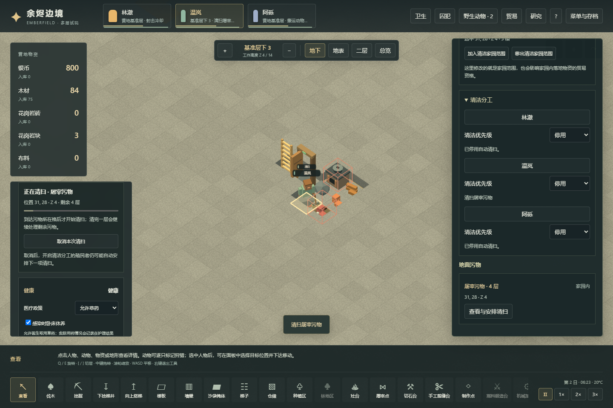
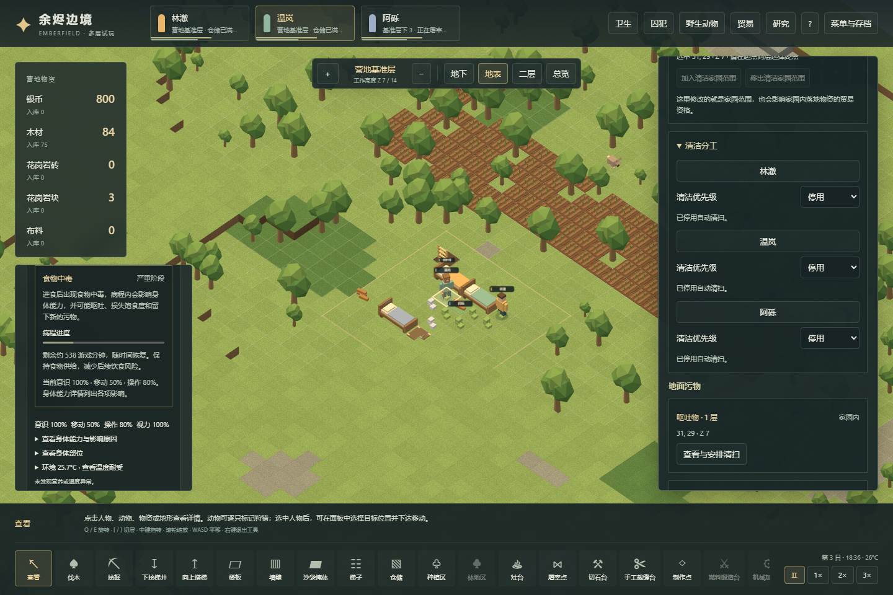

# 卫生、清洁与食物中毒的可玩流程

2026-11-04，存档版本25。本轮把卫生接入既有住房、屠宰、食品物流与健康系统。
玩法规则先连通，参数集中在 `src/voxel/sanitation.ts`，当前并非原版数值平衡结果。
[76原版机制](76-sanitation-food-poisoning-mechanisms.md)与
[77原版实机](77-native-sanitation-runtime.md)分别记录静态和运行证据。

## 玩家可以干预的流程

1. 行走带入泥土、受伤流血、屠宰和呕吐产生实际格子上的污物。画面可见污迹，检查可以看到类型和层数。
2. “卫生”面板查看房间洁净度与污物。清洁工作仅覆盖家园区域；需要把地下厨房等实际工作层纳入家园。
3. 在分工中启用清洁，或选择人员清扫指定污物。人物必须寻路到场并花时间逐层清除。征召、取消任务、取消家园范围等要释放预约。
4. 简餐在实际完成生产时按厨师技能与厨房卫生判定污染。已经产出的餐食不会因为房间随后被清扫而恢复安全；冷藏用于保存，不等于消除污染。
5. 搬运、分堆、合堆、交易、喂食和存档保留真实餐食污染状态。普通界面不直接标出隐藏污染餐。
6. 吃下污染餐后可能产生食物中毒，经历初期、严重和恢复期。身体能力与需求受影响，呕吐产生新污物；随病程自然恢复，不以药品瞬间消除。

房间清洁度也进入既有伤口护理的环境因子。具体感染仍遵循原有资格、判定时间和护理状态；打扫不能直接删除已发生的感染。

## 数据与边界

- 污物独立保存位置、类型、层数和产生时刻；同一污迹的层数影响清扫耗时，不把清洁度扣分重复乘以层数。
- 房间地形基础洁净使用房间拓扑缓存；污物和实体岩块参与当前结果。土质地面的环境属性与可清扫污物分开。
- 餐食按实际份数混合污染浓度；分出部分继承浓度。生产结果在输出空间阻塞时保留，重新加载不重新抽样。
- 中毒状态保存病程阶段和时刻，反复摄入不会生成多份相同疾病；已有严重或恢复阶段可以退回严重阶段起点。
- 新存档接受v1–v24升级。旧存档不补污物、不让旧餐重新抽污染、不新增食物或病人。
- 开放室外烹饪采用单独的环境风险，不把整张地图的污物平均后用于一座灶台。
- 体素首版清洁要求人物站到污物格；原版使用可接触位置，并有新污物等待期。本版暂未复刻该等待期。污物总量及同类层数有上限，避免长期经营无限增长。
- 病程保留三阶段与重复暴露机制，但总时长、呕吐节奏和能力系数仍是暂定参数；目前影响移动、操作和饥饿，不等于原版全部身体能力与疼痛效果。
- 当前只覆盖简餐生产污染。生食、腐尸、不同食材自带风险、动物中毒、更多污物类型与原版全套卫生建筑仍需继续扩展。

## 验证记录

验证范围区分以下层次，不能互相替代：

- `tests/voxel-sanitation-integration.test.ts`：显式控制场景，用于检查中断、重复预约、物品污染丢失、病程回读和非法存档。
- `scripts/voxel-sanitation-campaign-verify.mjs`：新世界的公开指令、正常时间推进和保存读取；实际建造地下厨房、狩猎屠宰、种植供粮、生产进食、清洁和恢复，不注入污物或疾病。
- `scripts/voxel-sanitation-browser-verify.mjs`：导入带哈希来源的真实经营检查点，通过可见界面验证两种渲染路径。

普通经营当前已从tick0运行到33889，通过37项检查。关键节点是地下厨房建成6290、真实屠宰留下污物22858、温岚实际进食后中毒27789、清扫开始29241、厨房污物清除30291、自然恢复33789。三名殖民者存活且可行动。13次真实采伐检查包含在37项内，不能当作37种不同功能。

检查点保存当前状态及SHA256，报告保留脚本与实际执行模拟bundle的SHA256。整个过程检查每种实物的生产、消耗、腐坏、损毁、贸易和剩余数量守恒。该场景证明这一固定种子下的流程可以发生，不证明污染概率已得到统计校准，也不证明长期粮食自给；本次水稻地已实际播种，但病程结束前尚未经历首轮作物收获。

最终本地全套802项测试通过，55个文件，无失败或跳过；进程正常以0结束（`test-results/v25-unit-final.json`，单个测试worker）。其中卫生规则6项、状态与调度边界8项、实际世界集成9项。另覆盖厨房输出受阻后保存读取不重新抽污染结果，以及真实流血污物进入伤口护理环境因子。生产类型检查和构建通过。

清洁与搬运都属于按世界状态即时生成的工作。本轮同时修正无普通施工任务时的分工排序，并用实际世界测试两个优先级方向；低优先级清洁不会抢在高优先级搬运前面。

正式构建的浏览器验证 Worker/main 各10项通过，页面与控制台错误均为空，实际加载的JS/CSS字节与本地构建一致（`test-results/voxel-sanitation-browser-build/report.json`）。检查涵盖家园矩形、手动与自动清扫、途中存档/取消、真实污物消失、病程显示、严重期实际呕吐、到期恢复及900px布局。首次脚本错误已修正：停用清洁分工会自动释放任务，不能再要求点击已消失的取消按钮；此次未因此修改产品代码。

其中同一厨房清扫前后洁净度由-1.1667变为-0.6667；天然地面仍有环境扣分。严重期的呕吐确实增加新的污物实体，恢复检查跨过原存档中的33789期限，未修改病程时钟。

所有测试在本地运行。Pages流水线保持安装依赖、类型检查、构建和部署。
