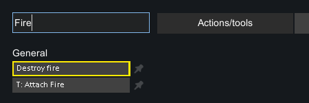
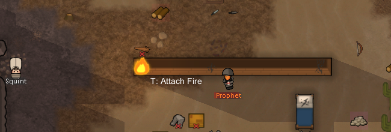
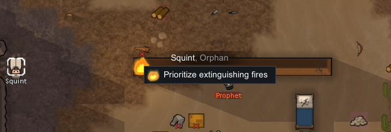
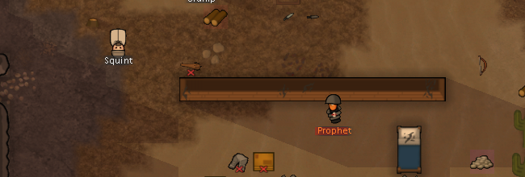

# 80 原版灭火：受控准备与普通指令

**观察结果：一个开发者准备的火源，在普通“Prioritize extinguishing fires”命令后消失，连续两次原生存档确认没有 Fire 实体。** 本轮使用 RimWorld 1.7.4980 rev60 原生 UI，不是 Web harness。开发者工具只准备一次火源；随后人物选择、右键命令、保存和退出都是普通 UI 操作。它不证明自然起火概率，也不测定单次扑打耗时。

完整精简记录见 [fire-runtime-evidence](evidence/fire-runtime-evidence.json)，静态依据见 [79](79-fire-firefighting-mechanisms.md) 与 [fire-evidence](evidence/fire-evidence.json)。

## 环境与准备

- 独立 `-savedatafolder`：`.local-research/runtime/profile-fire-20261104`；只在这份隔离研究配置/存档上操作。
- 激活 Core + Odyssey，复制配置已有开发者模式；进程 PID 17224，原生客户区 2560×1440。
- 基线复制自既有 prisoners 研究存档，复制前后 SHA256 相同：`ce0620ce2809fa582014cbbbe2302703d828585ebdb97f6260958fc65d88dc0d`。
- 没有修改存档 XML、注入游戏代码或使用内存 API。事后 XML 解析只用于取证，不能描述成仅凭屏幕读出的状态。

从加载到确认暂停之间游戏有推进，基线 203135 tick 到准备前存档 208028 tick 的差值 4893 不是灭火时长。Prophet 已有疾病并进入 tantrum，其他人物和访客也继续活动。这不是所有变量都锁死的实验室场景。

开发者 Actions 搜索 Fire 后，点击 **T: Attach Fire**，再点击已有木墙端点（客户端坐标 1655,1180）。截图中另一个高亮条目是 Destroy fire，但动作记录点击的是下方 Attach Fire 行（100,124），没有执行 Destroy fire。曾误入 Spawn thing 子菜单后返回，未执行生成物品。



`DebugToolsMisc.AttachFire` 对非可附着人物的所选格调用 `TryStartFireIn(...,1.75,...)`；此处生成 parent=null 的独立火 `Fire186400`，不是把木墙变成附着对象。墙为 `Wall41899 / WoodLog`，位置 `(104,0,126)`。准备后的局部画面：



## 普通右键与原生存档

退出开发者工具，选择 Squint（Human961），右键火源，普通菜单可见 `Prioritize extinguishing fires`：



点击后，在暂停下保存 `New Arrivals1.rws`。使用默认编号文件名，未重命名或编辑原始文件。

| 原生存档 | ticksGame | 全部 Fire 数 | 目标火 | Squint 当前 Job | 目标墙 HP |
|---|---:|---:|---|---|---:|
| fire-baseline | 203135 | 0 | 无 | 基线工作 | 195 |
| New Arrivals1 | 208028 | 1 | Fire186400，size1.75 | ExtinguishFiresNearby，playerForced=True，targetA=Thing_Fire186400 | 195 |
| New Arrivals2 | 208934 | 0 | 无 | Skygaze，startTick208527 | 188 |
| New Arrivals3 | 208934 | 0 | 无 | 同上 | 188 |

这里观察到的手动任务是 **`ExtinguishFiresNearby`，不是自动 WorkGiver 生成的 `BeatFire`**。由此追踪实际右键 provider 才发现其检查 Allowed area，没有 Home 门槛。自动静态消防仍要求 Home；两条入口不能混写。本次没有特意下达 Home 外命令，因此“手动入口没有 Home 检查”是静态调用链结论，不是这组画面直接验证的事实。

保存后返回暂停地图，仅做一次 speed3 的 2400ms bounded pulse，随后点击暂停。推进窗口为 906 game ticks，包含走路、扑火以及扑灭后的休闲，**不能把 906 ticks 或 2400ms 写成精确灭火工作量**。



存档 A/B 对照确认目标 Fire 已不存在，并且地图没有其他 Fire。两份结果存档 tick 完全相等，说明取证时没有继续推进。墙仍存在，HP 195→188，但附近 Prophet 正在发脾气损坏墙段；不能把这 7 HP 无条件全部归因于火焰，也没有验证维修过程。

## 退出与复核

第二份结果存档后用普通 **Quit to OS** 退出。退出后的截图尝试被前台窗口保护拒绝，没有伪造退出截图或成功动作条目；随后 CIM 查询没有 RimWorld.exe 进程。29 条成功记录的 UI 动作、四份存档 SHA256、四张小裁图及原图哈希均保留在 evidence 中，完整截图和原始存档仅留本地。

```powershell
pwsh -File scripts/research/collect-native-firefighting-runtime.ps1
node scripts/research/verify-fire-evidence.mjs
node scripts/research/verify-fire-evidence.mjs --local
```

collector 读取现有本地材料，不启动游戏。portable 校验提交材料和前后关系；local 额外核对本机原始文件哈希。校验通过不等于重新执行一次原生游戏实验。

本轮明确未做：自然/电路起火频率、扩散统计、雨雪/真空、人物着火、自动消防调度、Home 外手动命令、建筑修复、建筑财富变化。机制说明来自 79 的静态证据，Web 集成验证来自 [81](81-fire-gameplay.md)。
