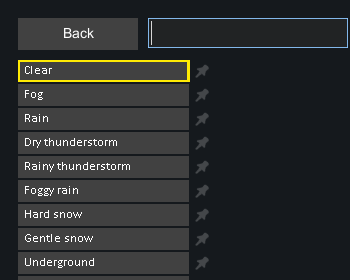
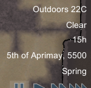
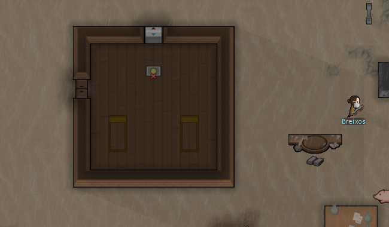
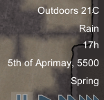
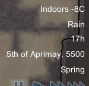
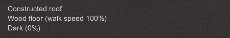
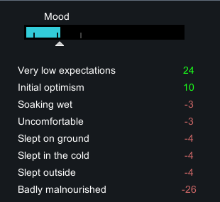

# 83 原版天气过渡与屋顶观察

本轮在 **RimWorld 1.7.4980 rev60** 的新隔离 profile 中，用开发者 UI 准备一次 Rain，再通过普通游戏运行、悬停、Needs 和原生存档确认：天气经历过渡后显示雨，屋内外仍共用全局天气标签，室外居民新增 Soaking wet −3。原版已正常退出。

这不是自然天气分布测试，也没有测移速、命中、太阳能或雨灭火。静态调用链见 [82](82-weather-mechanisms.md)，原始材料摘要、SHA256 和动作时间在 [weather-runtime-evidence](evidence/weather-runtime-evidence.json)，Web 测试另见 [84](84-weather-gameplay.md)。

## 隔离与准备

启动前确认没有其他 RimWorld.exe。新进程 PID **35300** 使用 `.local-research/runtime/profile-weather-20261104`，激活 Core + Odyssey；复制的隔离 Config 已启用开发者模式。基线来自既有 prisoners 研究档，源与副本 SHA256 都为 `ce0620ce2809fa582014cbbbe2302703d828585ebdb97f6260958fc65d88dc0d`。没有编辑存档 XML、注入游戏代码或修改正常玩家档。

输入助手只允许操作已核验路径/参数的目标进程，并在发送键鼠前验证前台窗口。原始客户区 2560×1440；仓库仅提交必要裁图。存档字段来自**事后 XML 解析**，与屏幕观察分别标记。

加载到确认暂停推进了 1800 ticks，后续保存的 Clear 状态为 204935 tick。此时室内冷房已有 −8℃，屋外约 22℃，不是雨水造成的低温。角色原有饥饿和伤病，未为了天气实验重置其状态。

从开发菜单选择 `Change weather... → Rain`：



这是明确的开发准备。该 action 只调用 `WeatherManager.TransitionTo`，不经自然天气权重选择，也不重新抽 WeatherDecider 持续时间；不能用后续持续长度估计自然雨天时长。

## 同 tick 保存证明“状态已变，显示尚未变”

| 原生保存 | ticksGame | current / previous | weather age | Squint 的 SoakingWet |
|---|---:|---|---:|---|
| weather-baseline | 203135 | Clear / Clear | 35492 | 无 |
| New Arrivals1（切换前） | 204935 | Clear / Clear | 37292 | 无 |
| New Arrivals2（准备后） | 204935 | Rain / Clear | 0 | 无 |
| New Arrivals3（运行后） | 209398 | Rain / Clear | 4463 | 1 条，age150 |
| New Arrivals4（重复保存） | 209398 | Rain / Clear | 4463 | 同上 |

两份准备前后保存 tick 完全相同，能够把天气字段变化和模拟时间推进区分开。刚选 Rain 时普通 HUD 仍显示 Clear：



随后只通过普通 speed3 做三段各 4000ms 的受控运行，每段结束点击暂停。总共推进 **4463 game ticks**，已跨过静态代码中的 4000 tick 过渡期。输入段墙钟时长不是帧率或速度校准；没有逐 tick 采样第一次出现雨标签/思想的时刻。



结果两份存档 tick 与 weather age 相同，确认最后取证时没有继续推进。天气标签已为 Rain。

## 屋内外提示与普通 Needs

把鼠标放到露天地面，显示 Outdoors 21℃；同一暂停时刻放到原有冷房中，显示 Indoors −8℃，底部明确 Constructed roof、Wood floor、Dark (0%)。两处仍显示同一个 Rain 标签。这里观察的是环境提示，不是控制人物进出屋顶做计时实验，也不意味着室内人物正在淋雨。

| 露天悬停 | 冷房悬停 |
|---|---|
|  |  |



选 Squint（Human961）打开普通 Needs 面板，清楚出现 **Soaking wet −3**。准备前两份原生存档都没有 SoakingWet；运行后的同 tick 存档都含一条该记忆。该证据支持“准备 Rain 后，普通模拟确实生成了淋湿思想”，没有将屏幕上的总体心情变化全部归因于天气。



没有在本轮测进屋后的干燥时间，也没有证明清除记忆的精确时刻。其时长和屋顶获取条件仍属于 82 的静态结论。

## 退出、证据与边界

第二份结果保存后使用普通 Quit to OS。进程退出后助手的截图被前台窗口保护拒绝，因此没有退出截图或成功的最后动作条目；随后 CIM 查询已无 RimWorld.exe。29 条成功 UI 动作、5 份原生存档哈希和 7 张小裁图保留在证据中，完整存档/截图留本地。

本次下午从 15h 推进到 17h，天文日光也在变化；不能从画面变暗推断雨使太阳能减产。原有冷房温度、伤病、饥饿和访客活动也没有固定。未额外准备雪、闪电、火灾或电器故障，没有将本次记录扩充成未做过的实验。

```powershell
pwsh -File scripts/research/collect-native-weather-runtime.ps1
node scripts/research/verify-weather-evidence.mjs
node scripts/research/verify-weather-evidence.mjs --local
```

采集脚本读取现存材料；验证器检查记录和本地文件完整性，均不会再次启动原版。便携校验通过只说明提交材料自洽，不等于重做了原生天气实验。
