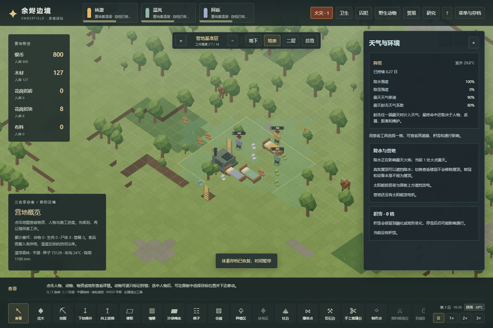
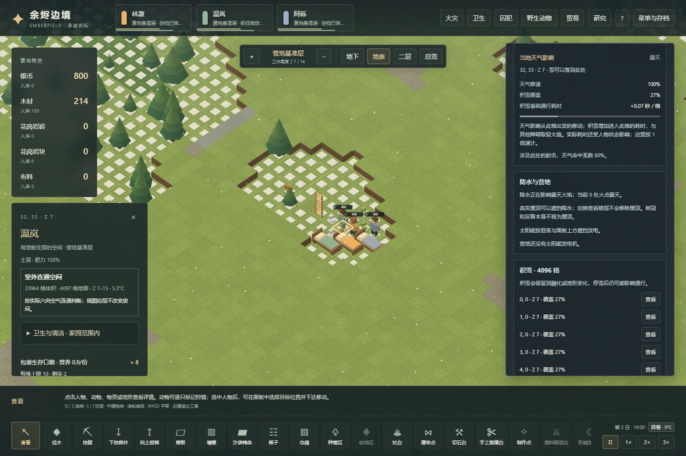

# 天气、降水、积雪与经营联动

2026-11-04，存档版本27。玩法机制优先，天气出现频率、雨灭火速度和视觉强度仍是暂定参数。
原版派生规则见[82](82-weather-mechanisms.md)，原版实机观察见[83](83-native-weather-runtime.md)。

## 已连接的行为

- 新营地与旧档迁移从晴天开始，之后按独立的确定性日历切换晴朗、雾、雨、雷雨或雪。降水、移动与命中系数在切换后逐步过渡；保存保留期限和过程，不因读档重新抽天气。
- 天气使用当地雨量与切换时温度选择降水，沿用既有昼夜和季节温度。当前仅为选定天气子集，未移植全部原版天气选择权重或大火求雨调度。
- 有降水时，露天火势先衰减，然后才进行该tick的损伤与蔓延。火焰仍可能在雨中点燃，强度不足时由降水扑灭；实际损伤不会被雨水恢复。原版SnowGentle的`rainRate`也大于零，因此代码中该参数表示参与灭火的降水强度，不能据此在画面同时制造一场大雨。
- 保留既有火灾机会日历和电网故障优先级。没有电气候选时，只有雷雨允许雷击点火；晴天记为跳过。本轮没有完整雷击事件频率、电池爆炸或雨天电器短路。
- 天气移动倍率只影响当前格露天的人物和动物；地面积雪增加进入格的时间，并与沙袋等障碍取较大值，不重复相加。取整仍使用Web的20TPS。寻路目前保留可达路线，不宣称已经按所有雪格成本寻得最快路径。
- 远程射击在射手或目标至少一端无顶时使用实际天气命中系数；双方有顶则豁免。树冠或设备自身不等价于屋顶。
- 雪在真实有支撑的空气格中积累，支持上层楼板顶面与后来被盖住的旧雪。新雪要求露天与室外温度房间；已有雪按当地温度融化。停雪不清空积雪，拆掉支撑才清除该格失效雪层。
- 普通雨雾的画面暗化不降低真实天空光上限，太阳能仍由昼夜与实际面板遮挡决定。这一点遵循当前选定原版Def，不能把画面色调变化当成发电惩罚。

## 三维几何和界面

降水遮蔽按完整世界每列最高实心方块计算，与切层视图、房间是否连通室外、树木及设备遮挡分别处理。露天棚下依然可能属于室外温度房间，但不直接淋雨；切开屋顶查看室内不能让室内下雪。

底栏的天气入口打开“天气与环境”面板，显示实际过渡中的强度、移动和射击系数，以及真实积雪位置。选中格可查看遮蔽和积雪的影响。雨雪粒子、地面积雪与色调由模拟状态驱动，暂停时天气动画冻结。没有供玩家或验收脚本修改天气、雪量和时钟的界面。

`weather.ts`集中定义日历和效果；`weatherPersistence.ts`校验日历、历史、雪深、唯一格与真实支撑；`world.ts`负责房间温度、移动和多层积雪，`fireWorld.ts`接降水灭火。屋顶缓存为4096字节，雪稀疏保存，不为每个空体素创建长期天气对象；`weatherBytes`为缓存及雪记录的估算，不是浏览器实际堆内存测量。

## 迁移与验证

真实v26的正常开局与实际起火检查点保留原始字节、原提交与SHA256，迁移只增加从原tick开始的晴天天气和空雪层。已有资源、火灾、损伤、人物和其他日历必须保持。用改版本号制作的受控旧schema测试与真实历史文件分别管理，不允许借迁移清空真实历史状态。

`voxel-weather.test.ts`覆盖确定性模型和非法存档，`voxel-weather-integration.test.ts`使用明确的受控几何/状态检验屋顶、灭火、射击、移动、雪层与太阳能的差异。

`scripts/voxel-weather-campaign-verify.mjs`以两个真实新营地验证普通经营：温暖营地实际取材、建床、搭梯铺上层楼板、挖矿发电，等待正常电气事件并观察自然降水灭火；寒冷营地实际经营后经历落雪、积雪行走、停雪保留与变暖融雪。种子按有界场景选择，不能用于证明天气概率已平衡。模拟状态查询用于规划和观察，修改仅通过正常指令、tick推进和存读。

最终源码的两个普通经营场景共通过32项检查。温暖营地在tick12185实际取得2个零件，13562建成并启动发电机；正常日历在27584点燃露天设备，关闭自动灭火分工后，降水在27673扑灭火焰，已经造成的损伤保留。寒冷营地在13000形成可通行雪层，征召人物在13015走到目标；14656停雪后仍有积雪，15000观测到升温后的可测融化，再存读并运行到15100。

首轮矿道规划触及上方仓储区的地基，支撑保护阻止开挖。验收改为用正常区域操作先取消相应仓储标记，保留实物后继续采矿；没有弱化支撑规则或注入零件。两场景持续核对生产、消耗、腐坏、损毁、进出口与剩余实物守恒，保存实际执行bundle、脚本和检查点的SHA256。种子选择与状态查询仅用于场景规划，天气本身按正常时间演进。

最终本地全套889项测试、59个文件全部通过，进程退出码0，无失败或跳过。新增天气模型34项与世界集成17项包含在总数内；集成测试还验证精神游荡跨屋顶边界时从出发格计算天气移动罚时，并通过实际移动时刻确认两方向分别为60/67 ticks。生产构建的类型检查和打包通过，进程退出码0。

最终生产预览的Worker与main两条渲染路径各通过10项网页检查，共20项；无页面或控制台错误，实际加载的6/5个JS和CSS文件均与最终dist字节一致。验收从普通经营检查点经可见界面导入，检查天气信息、屋顶遮蔽、暂停动画、存档连续性、降水实际灭火、雪地移动、切地下不制造降雪、停雪后的残留以及900像素宽布局。

发电机占地内的地图点击按既有交互选择设备锚点。首轮脚本误要求选中火焰所在的占地子格，现已核对请求格确属选中设备占地，并按实际选中格验证天气信息；生产交互没有为测试改写。浏览器仍通过正常速度推进观察火势与人物位置，未注入天气或直接调用隐藏的状态修改入口。

以下截图来自最终生产预览。雪的显示随查看楼层裁切，真实雪层位置与全世界的屋顶判断不随视图改变。

所有测试在本地运行，Pages保持仅安装依赖、类型检查、构建和部署。

## 尚未覆盖

完整天气/季节事件库、风力设备、湿身心情、雨洗污物、露天物品劣化、雨天设备短路、全地图雪成本寻路以及原版逐格Perlin积雪差异仍待扩展。既有太阳能核对是受控逻辑实验；普通经营流程没有为了测试而凭空添加太阳能板。
