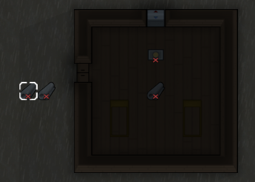
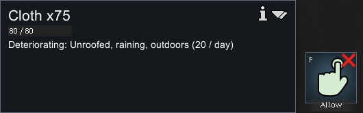
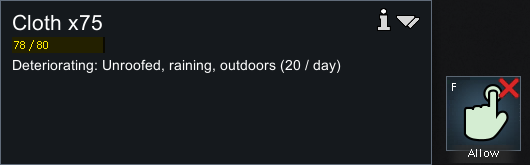
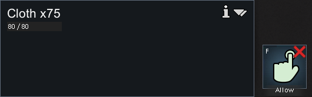
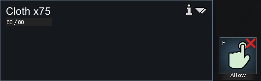

# 86 原版布料环境损耗与仓储对照

在 **RimWorld 1.7.4980 rev60** 原生 UI 中，开发者工具准备满栈布料，然后普通禁止搬运、运行、检查和保存。经过 **5946 game ticks**，选定露天布料从 **80/80 → 78/80**，封闭有顶房间的对照仍 **80/80**；两者数量都保持 75。原版已通过 Quit to OS 正常退出。

这次只确认一条可观察机制，未做长期损耗率标定。静态解释见 [85](85-environment-storage-mechanisms.md)，存档字段、动作时间、哈希、裁图来源见 [environment-storage-runtime-evidence](evidence/environment-storage-runtime-evidence.json)。

## 隔离与准备范围

启动使用新隔离 profile `.local-research/runtime/profile-environment-storage-20261104`，PID **34856**，Core + Odyssey。源自前轮天气研究的 `New Arrivals4.rws`，原文件与复制后的基线 SHA256 相同：`4073a394fee8d9f39c7221a6ad1fefdd52a050afc2a1fe158e42fc47f5f5b859`。Config 也从隔离目录复制，已有开发者模式。

雨继承前轮开发者准备的 Rain，没有在本轮再次切天气；不能当作自然降雨概率证据。未编辑存档 XML、注入游戏代码或修改正常玩家存档。输入助手核验进程路径、隔离参数和前台窗口；存档字段来自操作后解析，与截图可见事实分开保留。

加载到确认暂停先推进 **3693 ticks**。随后暂停中经 `Spawn full thing stack → Cloth`，在房间内与外各放一栈，再用普通 F 禁止搬运。原版工具按物品 stackLimit 准备，Cloth 为 75；ES11 保留相应静态入口。

准备时存在一次已披露的额外点击：Escape 打开菜单但没有取消生成工具，后续地图点击又生成相邻露天布料一栈。随后右键取消工具，三栈都禁止搬运并全部纳入存档记录。没有删除额外样本来制造两组整齐的结果。



## 普通物品面板的前后变化

| 位置 | 运行前 | 运行后 |
|---|---|---|
| 露天主样本 |  |  |
| 封闭房间对照 |  |  |

露天面板前后均写 `Deteriorating: Unroofed, raining, outdoors (20 / day)`；对照没有这行损耗提示。Cloth 基础 4 HP/天，露天满雨静态系数 5，得到 20/day，与本次 UI 展示一致。**UI 的速率提示不等于观察窗口已经验证了长期实际平均速率**。

四次普通 speed3 输入各持续 4000ms，随后点击暂停。它们是有界运行控制，并非帧率或模拟速度校准。没有逐 tick 观察每次掉血发生时刻。

## 原生存档提供身份与时标

| 保存 | ticksGame | current / previous | weather age |
|---|---:|---|---:|
| environment-storage-baseline | 209398 | Rain / Clear | 4463 |
| New Arrivals1：准备并禁止后 | 213091 | Rain / Clear | 8156 |
| New Arrivals2：运行后 | 219037 | Rain / Clear | 14102 |
| New Arrivals3：重复结果保存 | 219037 | Rain / Clear | 14102 |

测量段为 `219037−213091=5946 ticks`，不含加载时推进。前后都已超过前轮静态 4000 tick 的天气过渡期。最后两份原生保存 tick、天气与所选物资字段一致，确认取证时保持暂停。

| 物件 ID | 角色与位置 | 准备后 HP | 结果 HP | 数量 / 禁止搬运 |
|---|---|---:|---:|---|
| Cloth222220 | 封闭室内 `(104, 0, 140)` | 80 | 80 | 始终 75 / true |
| Cloth222221 | 露天主样本 `(97, 0, 140)` | 80 | 78 | 始终 75 / true |
| Cloth222222 | 额外露天栈 `(98, 0, 140)` | 80 | 78 | 始终 75 / true |

三者 spawnedTick 均为 213091，位置保持不变。原有 `Cloth78003` 也保留在证据摘要中，但它未禁止、数量为 55、准备前已有损伤，不作为新布料对照。

## 屋顶和地面证据及控制边界

| 房间内 | 主样本所在露天地面 |
|---|---|
|  |  |

原生悬停明确房间内有 Constructed roof、Wood floor，屋外为 Sand。房间已有冷却设备，观察时室内约 −12℃、室外约 16℃；这些温差不是本轮布料损耗造成的。布料不会腐败，木地板与沙地的选定 Core 父链均无额外损耗因子（见 85），但实验仍是“封闭有顶冷房木地板”对“无顶室外沙地”的整体存储条件对照，**不能宣称已经独立分离屋顶、围墙、温度和地面每个变量**。

本次支持露天雨中布料会损伤、封闭仓储对照未损伤、损伤作用于 HP 而数量不逐次减少。没有测棚子、货架、水面、衣物磨损、合堆、雨洗污渍或娱乐中断。淋湿证据沿用前轮 [83](83-native-weather-runtime.md)，不计作本轮新实验。

## 退出和可复核材料

第二份结果保存后普通点击 Quit to OS。进程退出后截图助手的前台保护拒绝了第 44 次退出截图，因此没有成功的退出截图或第 44 条动作。随后 CIM 查询已无 RimWorld.exe。证据保留 **43 条成功动作、4 份原生存档哈希、7 张裁图**；完整存档和 2560×1440 原始画面留在本地忽略目录。

```powershell
pwsh -File scripts/research/collect-native-environment-storage-runtime.ps1
node scripts/research/verify-environment-storage-evidence.mjs
node scripts/research/verify-environment-storage-evidence.mjs --local
```

这些命令读取现有材料并检查完整性，不重新启动或操作原版。通过校验说明记录、链接和文件哈希吻合，不等于重复原生实验或验证损耗概率分布。
