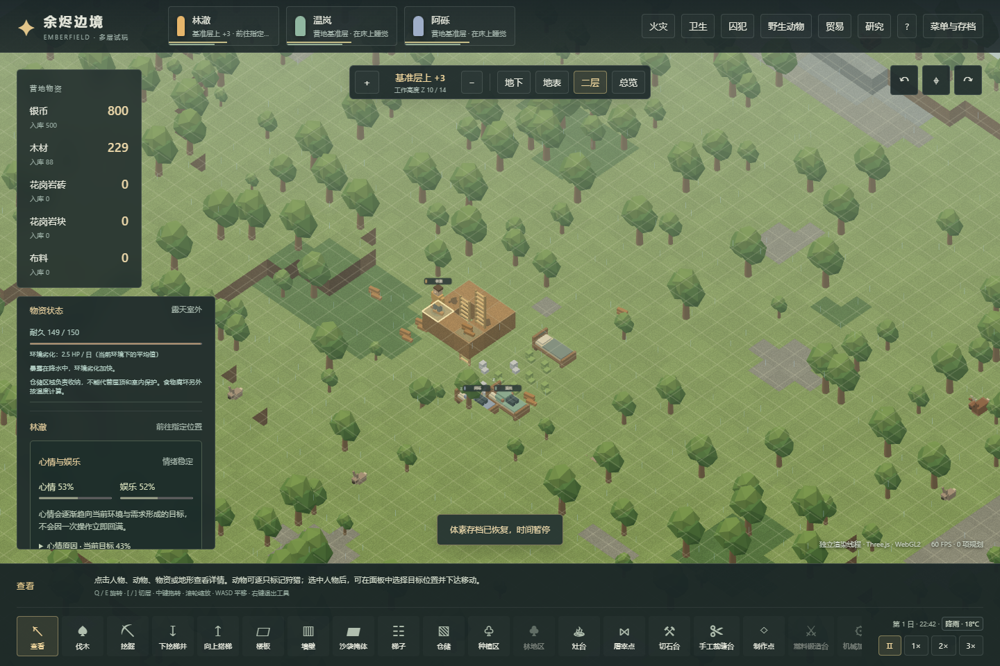
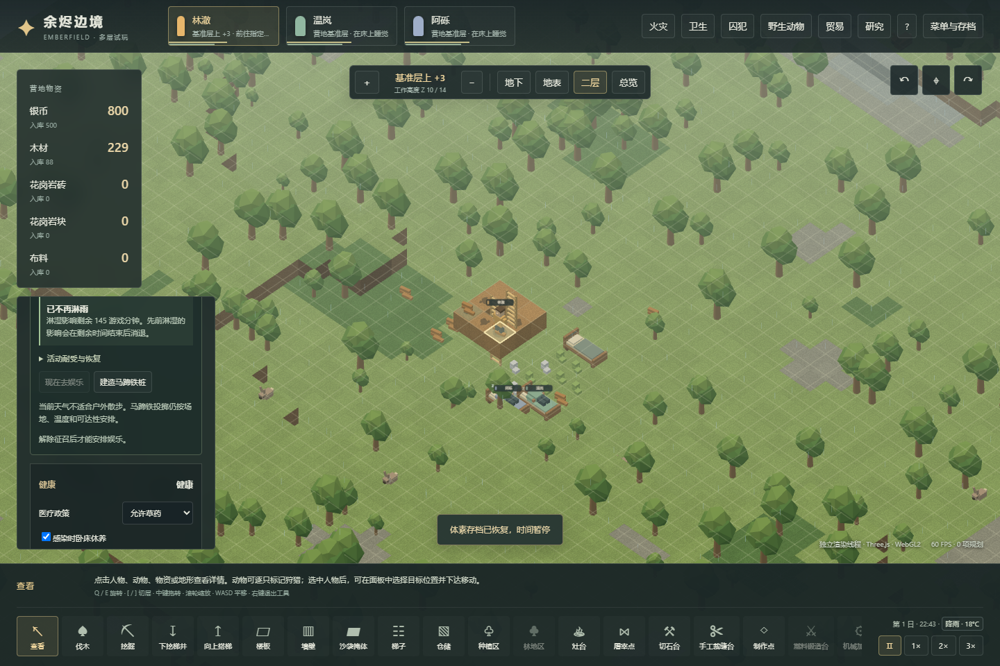
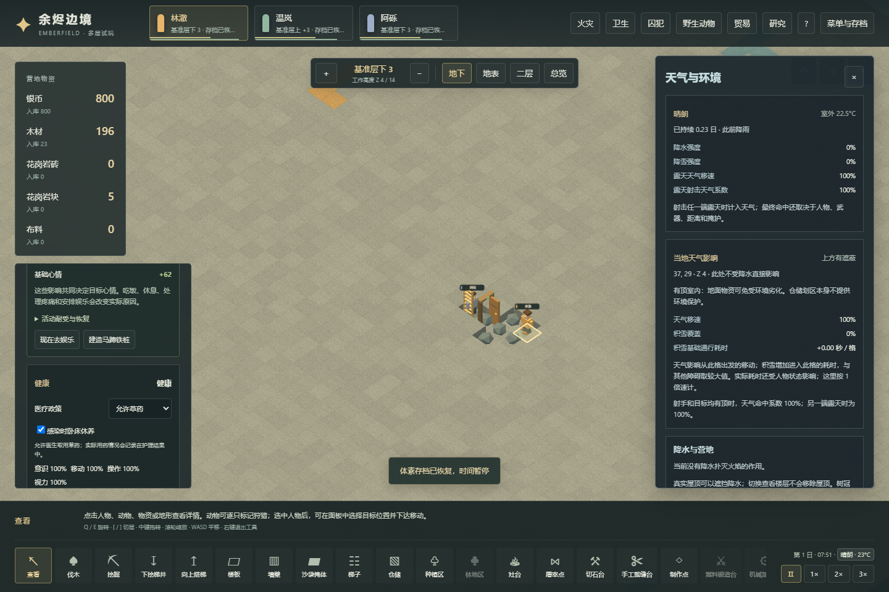

# v28：天气、日常活动与物资保护

本轮先把经营机制连接起来，平衡留待后续。原版派生代码和 Def 证据见 [85](85-environment-storage-mechanisms.md)，原版实机对照见 [86](86-native-environment-storage-runtime.md)。本文描述 Web 实现与验证，不能代替原版运行证据。

## 玩家可以怎样干预

下雨时，露天殖民者会反复刷新一条“淋湿了”记忆。进入屋顶下后停止刷新，已有记忆保留到自然到期；不是跨过屋檐就立刻恢复。雪的降水参数也参与清洁和物资环境判断，但当前选定原版雪 Def 没有淋湿思想，不能直接把降水强度当湿身开关。

户外散步受过渡中的降水影响，天气不合适时不能开始，进行中的散步也会结束。马蹄铁仍按设施、温度、可达性和人物状态安排。这里对应原版 GoForWalk 的 EnjoyableOutsideNow 检查，未套用 Skygaze 额外的当前天气 Def 门槛，也未扩展完整天空观赏事件。

雨水会逐层冲走当前四种映射污物的露天部分，屋顶下仍需清扫。清洁人员预留的污物被冲净后，会释放该任务；雨洗不计为人物劳动。当前四类都对应原版可雨洗 Def，不能推及原版所有污物。

地面物资按 HP 劣化，不会每次随机少一件。降到零才整堆损毁，并记入损毁账本、释放相关搬运、加工、装备或护理预留。选中物资可查看实际耐久、当前环境与平均劣化速度；食品的温度腐坏另行显示。

| 存放方式 | 遮雨 | 环境劣化 |
|---|---|---|
| 仅划仓储区 | 否 | 与未划区相同 |
| 有顶、与室外连通的棚子 | 是 | 保留室外部分 |
| 有顶的封闭房间 | 是 | 当前普通地面条件下为零 |

木材、布料、食物、零件等使用各自最大 HP 与基础速率；钢、银、石砖不使用这套 HP，石块有 HP 但环境速率为零。地面装备直接使用已有实例耐久及品质倍率，穿戴损耗仍由原系统负责，没有第二套隐藏装备 HP。无地面空间暂未转成物品的动物遗体也保留自己的尸体 HP。

## 实物状态与存档

拆分继承 HP，混堆按实际转入数量加权、向上取整。搬运、掉落、配送、取消建造退料、交易和收据均携带真实批次；接近满耐久时取整可能回到满值，这是明确保留的混堆规则。修复了混堆回到满值后，已有物品对象仍残留旧可选 HP 字段的问题。

施工任务现在保存全部 `deliveredBatches`，不再只有食材批次。消耗与数量账本仍逐资源核对。v28 迁移保留旧食材的年龄和污染，仅为旧档原本未记录实物状态的非易腐配送计数创建满耐久批次。真实 v27 配送中存档与积雪存档以原始字节、SHA-256、原仓库提交和发布提交保留在测试目录；历史版本夹带新 HP、湿记忆或新版配送字段会被拒绝，不能通过改版本号洗掉损伤。

地面劣化和雨洗使用独立的确定性采样，每 100 个 Web tick 更新一次，保存日均量级和整数伤害，不复刻原版全地图打乱的逐格访问。湿身检查每人物错开 24 tick；过渡中按前后天气中点选思想。Web 仍是 20 TPS、12000 tick/日；这些调度和日历为已披露的适配。

## 普通经营验证

`scripts/voxel-environment-campaign-verify.mjs`从真实新营地开始，只用正常玩家指令、时间推进和存读修改世界。状态查询用于规划，不注入天气、耐久、物资、泥土、心情、需求或人物位置。

正常伐木、建床后，人物搭两段梯子，在上层木平台一侧建屋顶。两处仓储实际搬入木材，正常脚步把泥土带到楼板上。tick 7354 的雨天检查点保留露天受损木材、正在淋雨的人物与可雨洗污物；tick 7364 人物已走到棚下，湿记忆继续保留，到 tick 8564 自然到期。露天污物被雨水冲净，棚下相同污物保留。

随后实际挖井、挖地下房间、建门，形成封闭仓库。使用真正空闲仓位避开挖掘产出的石块，再让人物走到受损木材旁搬运。tick 11929 入库物资保持携带批次的 HP，当前劣化速度为零。存读后继续运行到 tick 13429，仓内 HP 不变。全流程核对剩余实物、生产、消耗、腐坏、损毁、进出口守恒与殖民者存活。

最终本地全套 63 个测试文件、926 项测试全部通过，无失败或跳过，进程退出码 0；类型检查和生产构建通过。该普通流程共 32 项检查。浏览器的 Worker/main 各 11 项检查同时核对实际 JS/CSS 产物；900 像素宽下恢复存档提示位于两侧面板之间，不覆盖人物操作按钮。

可复现入口：

```sh
npm run test:voxel:environment
npm run test:voxel:environment:browser
npm run research:environment
```

浏览器脚本从普通经营产出的哈希检查点，通过可见导入、地图点击、速度按钮和导出操作检查 Worker/main 两种渲染路径。受控单元/集成测试另验证极低 HP 损毁、预留中断、退料、混堆和恶意存档边界；不能把这些构造场景称为正常游玩记录。具体最终检查数量与产物哈希见同目录 `evidence/voxel-environment-validation.json`。

全套回归首轮暴露出食物测试的长周期准备阻塞测试进程：同步推进八个以上游戏日，超出原 60 秒 hook 预算，并阻塞 Vitest RPC。准备阶段改为每 250 个正常 tick 让出一次事件循环，仍逐 tick 检查条件和物资账本，保留至少八日的真实种植要求。单独为这一长流程设 180 秒预算；没有改成注入成熟作物或跳过测试。







所有测试在本地执行。Pages 流水线继续只安装依赖、类型检查、构建和部署。

## 范围边界

本轮未加入保护货架、不同地表的额外劣化、完整污物 Def 库、全套思想条件和天空观赏玩法。携带和已配送材料保留耐久，但不会被当成地面物品重复采样。雨洗与劣化的概率分布、天气频率和生活节奏尚未系统平衡；原版布料对照也不代表所有物资速率已实测。
