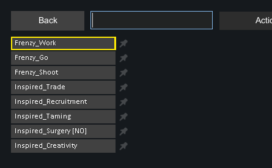
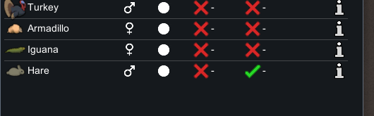
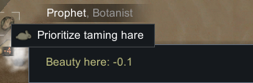
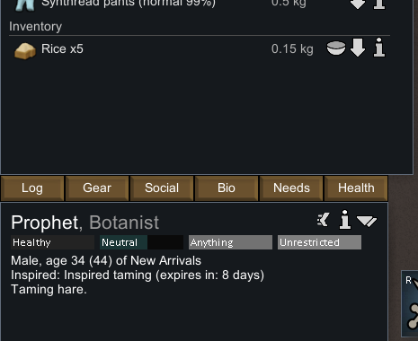
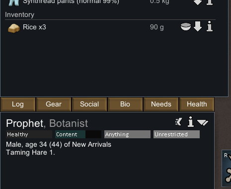
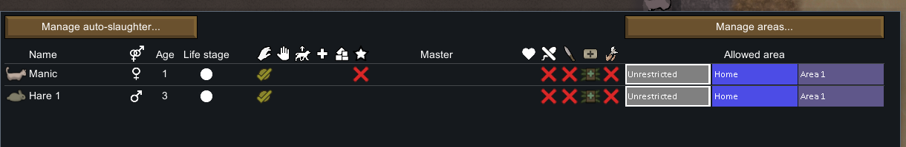

# 原生实验：拿取饲料、普通驯服与阵营转变

2026-11-04，RimWorld **1.7.4980 rev60**。本轮在独立档案目录观察到：Prophet 普通优先驯服一只野兔，先拿取米，再消耗饲料，最终命名 **Hare 1** 并加入 Animals 列表。

**成功条件经过开发者准备：Prophet 被授予 Inspired_Taming。** 该灵感保证最终检查成功并被消耗，所以本轮验证现场工作、资源消耗和状态转变，未验证自然成功概率。静态两轮喂食链见[88：机制与数值](88-animal-husbandry-mechanisms.md)。

## 环境与准备

完整记录见[运行时证据 JSON](evidence/animal-husbandry-runtime-evidence.json)：5 个原始存档身份、78 条成功输入/截图记录、7 张裁图、采样 tick、启动配置与退出检查。

原生进程使用 `F:\SteamLibrary\steamapps\common\RimWorld\RimWorld.exe`，PID 2128，启动 UTC `2026-11-03T20:48:30.6589150Z`。参数 `-savedatafolder` 指向本项目的 `.local-research/runtime/profile-animal-husbandry-20261104`，启用 Core 与 Odyssey。原始全屏和存档留在忽略目录，公共仓库仅保留必要字段、哈希和裁图。

基线复制自已有本地实验档 `profile-20261102/Saves/apparel-entry-a.rws`，源与副本 SHA-256 相同：`efc89a5038908d4eac02e88a5e9360a449aa82c2bc26beeabd963eb2b40815d0`。没有修改用户日常存档、没有编辑 XML、没有注入程序集。

使用现有殖民者 Mitchell “Prophet” Cook，`Human958`，Animals 等级 12；没有改技能或治愈。Handling 已开启。开发者菜单只做三项准备：

1. `Spawn Pawn → Hare`：生成一只野兔 `Hare113769`。
2. `Spawn full thing stack → RawRice`：生成 75 米，`RawRice113770`。
3. `Inspiration → Inspired_Taming`：给予 Prophet 灵感。

没有使用开发者直接驯服、修改阵营或强制招募。此后使用普通 Wildlife 驯服勾选、右键 `Prioritize taming hare`、正常时间流动、查看面板和游戏保存菜单。



输入记录完整保留了准备中的两次纠正：初次搜索误点 Back，清除后重新进入正确子菜单；第一次给予灵感时因镜头移动点空，随后按新的角色位置成功给予。没有因此额外生成动物或米堆。

## 可观察链路

Wildlife 中为野兔勾选驯服；普通右键菜单提供优先驯服任务：





先运行两次各 1,000 ms 的速度 3 脉冲。Prophet 物品栏出现 **Rice ×5**，状态仍是 `Taming hare`，灵感仍在。存档中的普通工作为 `Tame`，动物目标 `Thing_Hare113769`、食物目标 `Thing_RawRice113770`、`count=5`、`playerForced=True`。这里的 forced 是玩家普通优先工作命令，不是开发者强制成功。



再运行 2,500 ms 和 4,000 ms 的速度 3 脉冲。前一段检查时角色仍在接近目标，不能把该截图名中的 `feeding` 当作喂食已经发生的证据。后一段出现普通消息：成功驯服野兔，命名 Hare 1，灵感结束；物品栏成为 **Rice ×3**。




Animals 页新增 Hare 1（雄性，年龄显示 3），原有 Manic 仍在：



## 原始存档交叉核对

下表文件均位于独立 profile 的 `Saves` 目录，每份 SHA-256 与精简 XML 在证据 JSON 中。

| 文件 | ticksGame | 目标野兔 | 地面米 | Prophet 物品栏米 | 灵感 / 驯服指定 |
|---|---:|---|---:|---:|---|
| `animal-husbandry-baseline.rws` | 69,526 | 目标 ID 不存在 | 目标 ID 不存在 | 0 | 无 / 无 |
| `New Arrivals1.rws` | 72,541 | 无阵营，未命名 | 75 | 0 | 有 / 有 |
| `New Arrivals2.rws` | 73,375 | 无阵营，未命名 | 70 | 5 | 有 / 有 |
| `New Arrivals3.rws` | 75,812 | Faction_12，Hare 1 | 70 | 3 | 无 / 无 |
| `New Arrivals4.rws` | 75,812 | 与上一档相同 | 70 | 3 | 无 / 无 |

准备时野兔位于 `(108,0,134)`，米堆位于 `(104,0,137)`；两者的 `spawnedTick=72541`。拿到物品栏的米分堆身份为 `RawRice113776`，后续身份不变，数量 5→3。地面同一堆保持 70，能够区分“拿走五份”和“实际吃掉两份”。

最终野兔阵营与 Prophet 同为 `Faction_12`，名称为 `NameSingle/Hare 1`，驯服指定已经清除；Prophet 的灵感为 `curState IsNull=True`。最终两个存档的 tick 与选取状态相同；未声称整个存档字节相同或做过重新加载验证。

存档包含训练 `DefMap` 的密集数组，本轮仅原样保留，不把数组第几个元素当作可移植的 Def 标识。Tameness 初始化机制由静态 `SetFaction/Train` 和 TrainableDef 另行支撑。

## 时间与证据边界

- 载入至准备保存前推进了 **3,015 ticks**。初次 40 ms 速度 1 操作仅用于确认暂停，独立列出。
- 准备到拿到米为 **834 ticks**。
- 准备到最终成功状态的采样窗口为 **3,271 ticks**。
- 四次速度 3 脉冲为 `1000 / 1000 / 2500 / 4000 ms`。窗口包含走路、追逐移动目标、交流和喂食，未测量第一轮喂食或最终抽签的精确 tick。
- 前后物品栏和资源身份表明此次交互净消耗两份米；“两轮喂食”由静态工作链说明，未逐帧独立采样每一轮。
- 最终面板及工作 XML 短暂仍显示 `Tame/Taming Hare 1`，但成功消息、命名、阵营、Animals 页和指定清除已经一致。没有把工作清理结束时刻也说成已经测过。
- 没有本轮原生自主吃草、长期投喂、随机失败、反击、交配、产仔、饿死或退野实验。

完成双份最终保存后通过普通 `Quit to OS` 退出。退出点击之后，截图工具的前台窗口校验失败，因此没有第 79 条成功截图/动作记录；CIM 随后确认没有 `RimWorld.exe` 进程。不能把缺少退出截图描述为仍在运行，也不能捏造一张退出截图。

## 复核命令

```powershell
pwsh -File scripts/research/collect-native-animal-husbandry-runtime.ps1
node scripts/research/verify-animal-husbandry-evidence.mjs
node scripts/research/verify-animal-husbandry-evidence.mjs --local
```

收集器只读取本地原件、裁图并生成摘要，不重启游戏。输入 helper `scripts/research/animal-husbandry-runtime-input.ps1` 保留了当时的具体进程、安装路径、独立 profile 和前台窗口防误操作检查。验证器检查的是存储证据完整性，不能替代一次新的原生重放。
