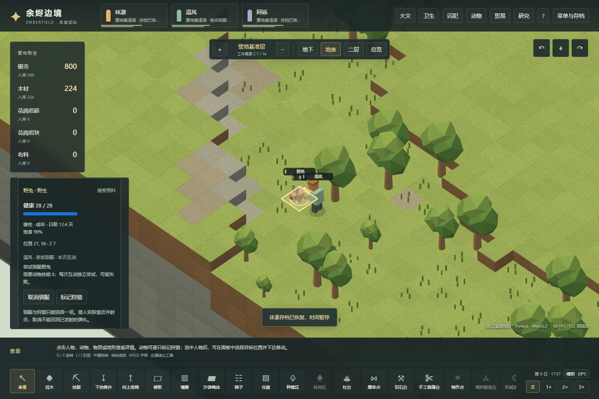
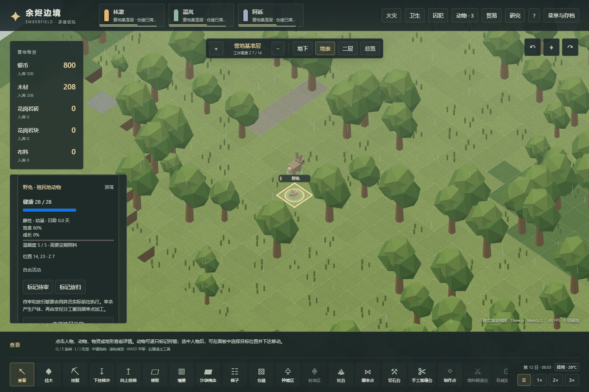

# v29：动物驯养与繁殖

本轮先完成可操作的经营循环：种植收获 → 驯养员拿取真实粮食 → 靠近并两次喂食 → 驯服成功或失败 → 家畜进食、交配、怀孕、出生与成长 → 放归或宰杀 → 尸体搬运、屠宰与烹饪。原版证据见[88机制](88-animal-husbandry-mechanisms.md)和[89实机](89-native-animal-husbandry-runtime.md)。本章记录 Emberfield 的实现，数值仍是可调整的初步参数。

## 玩家操作

在分工中开启“驯养”，准备收获的生粮。驯服兔与鹿需要动物技能 8 级，初始温岚具备资格。选择野生动物，标记驯服；与狩猎标记互斥。殖民者必须实际走到粮堆，携带足够一次尝试的食物，再走到动物身边，分两次喂食。食物从真实库存扣除；失败后保留野生身份并等待冷却，不累积一个必然成功的“驯服进度”。

驯服后，动物在同一世界中活动。草是有位置和有限生长量的实体，吃草会减少草量，合适日照与温度下再生；裸露土壤不能直接补充营养。动物也会吃田间作物和可达的地面食物。殖民者会给饥饿家畜实际送食，生粮仓储可以作为投喂位置，不能凭空增加饲料。动物不能爬梯：地下和楼上饲养需要实际可通行的台阶路线。鹿只能通过敞开或当时已打开的门；殖民地兔可通过未锁的自动门。

同种、成年、异性且属于殖民地的动物，需要实际接触才能交配。已有孕母体不会重复受孕；饥饿会减缓或暂停孕期和幼体成长，严重营养不良会流产，持续饥饿会死亡。出生需要附近合法空位与剩余动物容量，不能在堵死的房间中无限重叠生成。幼体保留自己的身份、性别、日龄和成长状态，逐渐变为成年。

“待宰”和“放归”也是现场工作：殖民者必须靠近并完成互动。宰杀后只有一具对应身份的尸体，继续走既有加工流程。放归保留原动物，改变归属。兔子的驯顺会逐格退化，驯养员用真实食物维护；长期忽略后可能恢复野生。鹿不使用这一退野机制。

动物详情、列表和事件记录显示归属、性别、日龄、成长、孕期、饱食、营养不良及当前活动。渲染显示草量、幼体大小、家畜标识，成年雄鹿有角；劳动动作由实际互动阶段驱动。模拟与显示继续分离。

## 权威状态和兼容

v29 存档加入动物归属、性别、年龄与成长、营养不良、孕期、驯顺维护、食物和配偶目标、路径及驯养工作阶段。已喂食次数、未用食物、腐坏和耐久均随任务保存；取消、征召、饥饿中断或目标死亡会释放预约，已消耗的食物不会退回，未用食物仍是实体。

v28 迁移只追加过去未表示的状态。旧动物原有身份、位置、健康、饱食、行为、狩猎标记和尸体耐久保留；旧物资、技能进度、天气、污物、建筑及账本保留。旧动物初始化为成年野生动物，性别使用不同于物种选择的身份位，避免每种动物全部同性。草地只在旧档首次升级时按现有地形初始化；再次读档不补回已吃掉的草，也不重复生成动物。

物资预留与护理、搬运共享可用数量；交易或损毁使预留粮堆失效时，同一次操作取消取食任务。物资目标可能在同一 tick 被其他事件移除，下一次动物决策重新寻找；历史父代和事件身份不要求对象仍活在地图中。数组、路径、日志和种群均有容量上限。

## 本地验证

普通经营脚本为 `npm run test:voxel:husbandry`：从新营地通过公开玩家命令种田、收获、准备食物、驯服雌雄、繁殖与成长，再完成放归和真实尸体加工。脚本每步核对实物账本，保存中间检查点与运行 bundle 哈希，不注入家畜、食物、孕期或成长。

浏览器脚本为 `npm run test:voxel:husbandry:browser`：分别验证渲染 Worker 和主线程，从上述普通经营产生的存档继续，使用实际按钮、地图选择、文件导入与导出；检查驯服消耗、出生、成长、取消、放归、宰杀及响应式布局。最终结果冻结到 `evidence/voxel-husbandry-validation.json`，与原版运行证据分开。

定向测试覆盖食物不足和技能门槛、实际拿取与两次喂食、任务中途读档、取消剩余食物、狩猎互斥、有限草与裸地、物种门通行、同层接触、怀孕、出生阻塞、营养不良、尸体唯一身份和交易取消预约。另用真实 v28 原始检查点验证迁移，包括已受损的木材。测试全部在本地执行；Pages 仍只安装依赖、类型检查、构建和部署。

2026-11-04 最终本地结果：**969/969 项测试、67/67 个文件通过，无跳过项**。普通经营 **23/23 项检查通过**，终点 tick **181,070**，约 15.09 游戏日；期间三个初始殖民者均存活并可行动。首只兔在 tick 100,993 驯服，配对后在 108,015 受孕、132,014 出生，幼体保持同一身份并在 180,014 成年。草的实际采食检查中，同格生长量从 1 减到 0.5，动物饱食从约 63.89% 增到 100%。这些是一次有界经营结果，未作概率或长期平衡校准。

生产构建通过；渲染 Worker 与主线程各 **17/17 项浏览器检查通过**，均无页面或控制台错误，加载资产的 HTTP 状态和 SHA-256 与本地产物一致。浏览器从上述经营产生的真实检查点继续操作，未独立从头重跑全部 15 天。脚本与运行 bundle、检查点及截图哈希记录在[冻结验证摘要](evidence/voxel-husbandry-validation.json)。

## 当前差异与后续

- 尚未实现完整围栏识别、围栏标记、牵引、允许区域、野生漫游离图。现有墙与门提供物理隔离；这一子集不能视为原版的完整圈养系统。
- 尚无动物训练指令、畜产品、挤奶剪毛、载畜运输、绝育、动物手术和完整动物身体伤情。本轮兔和鹿没有搬运或战斗训练。
- 本版每次产一只幼崽，孕期两游戏日、正常成长四游戏日。原版孕期、成长与窝仔数单独记录，未据此声称已经还原其平衡。
- 驯服概率、冷却、饥饿与草量使用集中参数；流产采用营养不良阈值。未加入原版驯服失败后的完整狂暴反击链，也未做概率分布校准。
- 草地是有限的原位再生植被；尚不包含完整野生草扩散、动物营养选择、产仔遗传、血缘和社会关系。当前环境温度影响草生长，尚无完整动物冷热伤害模型。

这些边界明确保留为后续机制任务，先保证已接通的操作具有真实资源成本和可观察的后果。
