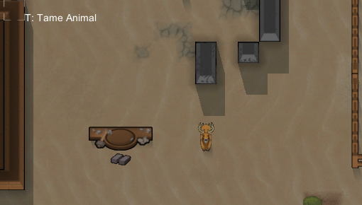
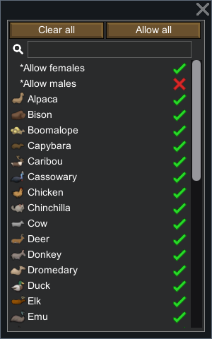
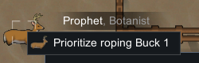
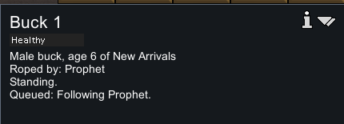
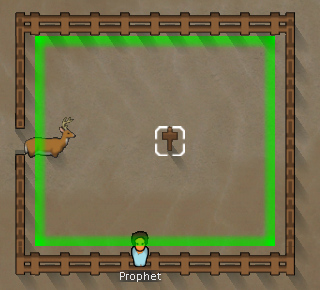
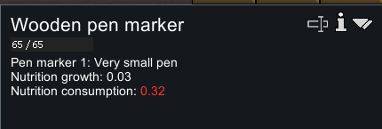
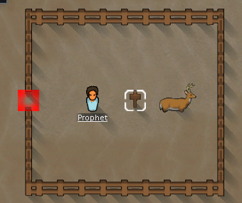
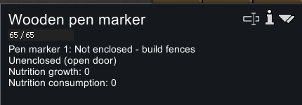
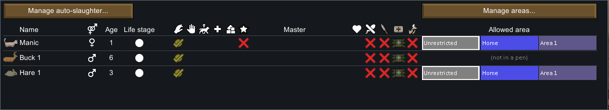

# 92 · 原版圈养实机：筛选、挂绳、入圈与保持开门

本轮在 **RimWorld 1.7.4980 rev60 / Core + Odyssey** 的独立研究配置中完成。原版进程已通过普通 **Quit to OS** 退出，CIM 复查无 RimWorld 进程。没有代码注入、编辑存档或修改原版程序集。

## 准备与普通操作边界

独立配置目录为 `.local-research/runtime/profile-animal-pens-20261104`。基线复制上一轮已完成驯服的原始存档，两文件 SHA-256 相同：`651abba413f1aa854754fa752ca01bba16e23e200fc65ab62b519ea6668ea70f`。本轮只在独立 Prefs 中把 `pauseOnLoad` 从 False 改为 True；读档后仍有 1 tick 进入准备窗口，不能称绝对零推进。

开发者准备包括：God mode 即时建造木围栏、木圈门、圈标记；Spawn Pawn 生成一只 Deer；Tame Animal 直接把它变为玩家公鹿 Buck 1。随后关闭 God mode。开发者驯服通知提到 Grump，不代表 Grump 进行了普通驯服。建筑成本、工时、鹿的自然驯服概率均不在本轮实测范围。

普通操作包括：圈标记雌雄筛选、右键 Prioritize roping、运行模拟、普通保存/读档、圈门 Hold open、征召后让角色实际穿门以及打开 Animals 名单。输入工具仅发鼠标键盘事件并截图，操作日志另行保留。



完整静态解释见 [91 · 动物圈养机制](91-animal-pens-mechanisms.md)；[运行证据 JSON](evidence/animal-pens-runtime-evidence.json) 保留每份原始存档哈希、对象投影、截图裁切坐标和动作记录。

## 存档时间线与读档分支

| 原始存档 | ticksGame | 证据含义 |
|---|---:|---|
| animal-pens-baseline | 75812 | 原基线，有 Prophet 与 Hare 1；没有本轮鹿/圈门/标记 |
| New Arrivals1 | 75813 | 开发者准备完成，普通筛选禁止雄性；鹿仍在圈外 |
| New Arrivals2 | 76651 | 普通 RopeToPen 接近阶段，尚未挂绳 |
| New Arrivals3 | 77073 | 首次进入圈内并放绳，角色恢复 FeedPatient |
| New Arrivals4 | 76756 | **普通重载 New Arrivals2 后**补采，确切双向挂绳状态 |
| New Arrivals5 | 77990 | 第二分支入圈后，普通保持开门导致未封闭 |
| New Arrivals6 | 77990 | 同暂停状态再次保存，选定对象状态一致 |

这是两段明确记录的实机观察，不能按文件编号拼接成单调递增的模拟时间线。第一次采样步长错过了挂绳中态，因此普通读档补采；不是修改存档制造绳索状态，也不是统计重复实验。

## 1. 性别筛选真正影响目标圈许可

Animals 过滤器默认允许雌雄。关闭 `Allow males` 后，存档中 `animalFilter/disallowedSpecialFilters` 出现 `AllowMaleGender`；Deer 仍在 `allowedDefs`。恢复雄性许可后，“需要圈栏”提示消失，随后普通右键可下达优先牵引。





这里只测试性别开关；不把物种排除、年龄过滤或多个圈之间的重平衡称为已实测。

## 2. 任务开始与实际挂绳分开取证

`New Arrivals2` 中 Prophet `Human958` 执行 `RopeToPen`，`playerForced=True`，`workGiverDef=TakeToPen`；目标动物 `Deer149579`，目标标记 `PenMarker149578`。此时双方 roping 尚空，截图中的目标线不足以证明实际挂绳。

普通重载这份存档，用较短的模拟片段补采后，`New Arrivals4` 明确记录：

```text
tick 76756
Human958 position = (121, 0, 141)
Human958 roping.ropees = [Thing_Deer149579]
Human958 job = RopeToPen
Deer149579 position = (121, 0, 140)
Deer149579 roping.ropedTo = Thing_Human958
Deer149579 job = Wait (expiryInterval=30)
Deer149579 queued job = FollowRoper (target Human958)
```

双方严格相邻；动物检查面板显示 `Roped by: Prophet` 和待执行的跟随任务。这个样本对应挂绳后的等待阶段，不宣称采到了每一格跟随路径。



## 3. 实际进入圈内，再解除绳索

圈门 `FenceGate149577` 在 `(124,0,141)`，圈标记在 `(129,0,141)`。首段完成档 `New Arrivals3` 的公鹿位置为 `(125,0,141)`，即跨过圈门的圈内相邻格；双方绳索清空，Prophet 已恢复 `FeedPatient`。圈标记显示绿色封闭边界，营养消耗变为 0.32。





第二段补采在挂绳样本后也运行到圈内，再进行开门实验。存档位置、任务迁移和面板共同支持“实际牵入后释放”；没有利用开发者瞬移。没有把脉冲的墙钟时间当成牵引工时。

## 4. 保持开门改变封闭性，但动物没有立刻消失

普通选中圈门，开启 Hold open；征召 Prophet，让他走到门外相邻格，再普通移动到门内。圈门实际打开后，标记出现红色出口，说明 `Not enclosed - build fences / Unenclosed (open door)`，右侧警报也出现 `Pen not enclosed`。





最终两档均在 77990 tick，圈门 `open=True`、`holdOpen=True`；鹿仍生成在地图内并属于玩家。这里证明的是门状态导致失去封闭性，没有观察永久走失、退野或离图。该时间还未过自然 Roaming 的 300000 tick 开局宽限。

## 5. 兔子区域与鹿圈栏在名单中分开显示

原版 Animals 名单中，Hare 1 显示 Unrestricted / Home / Area 1 按钮；Buck 1 显示 `(not in a pen)`。本轮没有更改兔子的区域，也没有测它返区的路径。



## 记录完整性与限制

保留 99 个成功输入记录和对应全屏原图，公开 9 张相关裁图；7 份原始存档保留本地，仅公开投影与哈希。第 100 次操作已发送退出点击，但程序退出后截图前台检查失败，所以没有虚构第 100 条成功日志或退出截图。

准备期间有一次重复放置标记被拒绝；早期右键菜单因鼠标移出过远自动消失，之后保持光标附近才成功保留；第 62 次 pulse 发生在尚未关闭的退出菜单上，不能算有效模拟窗口。这些操作校正保留在日志和 evidence 的限制项里。

数值不作校准：未测普通建造、自然鹿驯服、围栏损毁、物种排除、多圈重平衡、兔子返区、长期供草/繁殖、自然漫游概率及最终离图。验证脚本只检查证据哈希、字段、关联与分支一致性，不重放原版。

```powershell
node scripts/research/verify-animal-pens-evidence.mjs
node scripts/research/verify-animal-pens-evidence.mjs --local
```

`--local` 还要求本机原始存档、全屏截图、动作日志、派生类型及固定版本游戏文件存在。
