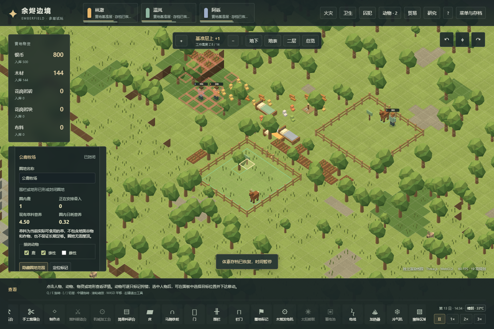
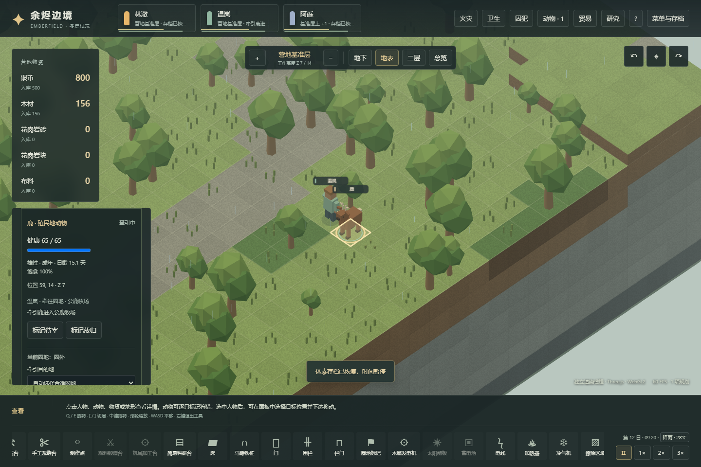
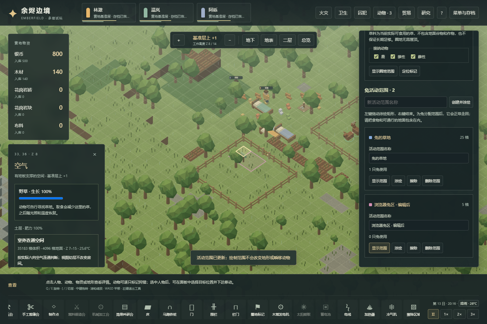

# v30：围栏、圈地、牵引与动物活动范围

本轮把动物经营接到真实空间管理上：建造围栏与栏门 → 完成圈地标记 → 检查三维封闭性与接纳条件 → 饲养员靠近挂绳 → 双方沿合法通路移动 → 动物进入圈地后解绳。兔使用允许活动区域，鹿使用物理围栏。数值集中在 `src/voxel/pens.ts`，先保证机制可操作、可中断、可保存，再调整工作速度与漫游频率。

原版静态依据见[91机制研究](91-animal-pens-mechanisms.md)，开发准备后使用普通玩家操作的观察见[92原版实机](92-native-animal-pens-runtime.md)。本章的三维地形、Web参数和运行结果与原版证据分别记录。

## 玩家操作

打开“动物”中的“圈地与范围”。围栏支持按住左键拖动连续直线施工，栏门和圈地标记单点放置。必须留出栏门位置；蓝图尚未施工时不会形成边界。建造沿用实际木材配送、施工劳动、满地物资等待和拆除退料流程。

圈地内建好标记后，界面显示是否封闭、原因、共用同一圈地的其他标记、实际动物、现存野草营养和动物日需求。后两项是当前状态，不是固定“容量”或保证还能维持多少天。普通标记筛选鹿、雄性和雌性，不增加原版普通标记没有的年龄筛选。可以命名标记、指定某只鹿的目标圈地或恢复自动选择。

驯服后开启人物的驯养分工。牵引没有驯服所需的动物技能门槛；人物需要可行动、未征召且有有效路径。饲养员走到动物同层四邻，完成挂绳，带动物穿过栏门，到动物本身进入圈地才解绳。挂绳前动物仍自由活动，因此靠近路径可能重算。牵引过程中可暂停、征召人物、变更目的地或筛选；中断保留双方实际位置。

栏门有自动、保持敞开和锁定三种模式。自动开门的短暂通行不改变圈地封闭状态；保持敞开会打通边界，锁定则阻止牵引通过。人和兔可以缓慢跨过低围栏，鹿不能；饲养员牵着鹿时也不能借助自己的跨栏或爬梯能力把动物拖过去。

为兔创建活动范围后，在当前楼层拖动矩形涂绘或擦除，再分配给殖民地兔。区域约束普通觅食、配偶和闲逛目标；区域外的兔会沿真实路线回来，返回途中允许经过区域外。空区域或不可达区域会显示原因，不瞬移、不改变地形。逃避威胁时可以暂时离开。新生兔继承母体区域；删除区域或实际放归后清除对应分配。

## 三维通路与跨系统约束

- 圈地由地面可行走图的连通分量判断：到达任一水平地图边界就是未封闭。无需屋顶，实际坡道或高处通路能使二维看似围住的空间泄漏；纯竖直梯子不属于动物通路。
- 多个标记可共享一个物理圈地。缓存同一连通分量，避免每个标记重新遍历；区域集合用于普通目标查询，数量与路径均有上限。
- 牵引寻路记录相邻的“动物格、人物格”。人物每走一步，动物走到人物上一格；两条边都须合法，不交换穿模。尝试不同挂绳位置，避免狭道方向不合适时误报无路。双方各自等待移动时钟和门打开。
- 围栏、栏门和标记有实际身份、材料成本、结构耐久及建筑财富；火灾可留下损伤供施工人员修理，也能烧毁结构、打开圈地。拆除标记清除对应目标与牵引任务。
- 未圈养殖民地鹿在初始宽限期后可能开始向边缘漫游；只有真的走到边缘才移出地图并记录事件。围栏出现缺口不会立刻删掉动物，也不等同于兔的驯顺退化。
- 圈地不是自动饲料来源。既有有限野草、作物和实体食物规则继续生效，圈内饥饿仍需补充可达饲料。

## 存档与初步参数

v30保存围栏、栏门、标记、区域、动物分配与漫游时钟，以及人物的靠近、挂绳、牵行、解绳阶段。派生圈地格子不写入存档；回读重建拓扑、核验双方位置和每个牵行步，失效路线在原地释放。有效途中任务保留进度和路径。

v29和更早档只新增空建筑/区域列表、空绳索任务及管理默认值，不补发材料、不新生成家畜、不推进孕期或成长。真实v29搬粮、孕期和新生儿检查点以原字节纳入迁移测试，保留来源与SHA-256。旧版本夹带新版动作或字段会被拒绝。

围栏/栏门/标记目前只支持木材。材料数量取选定Core基础值，工作量使用Web时间尺度；完整材料属性倍率尚未实现。牵引工作量、漫游检查周期和概率是可调整的Web参数，不声称校准了原版长期分布。5游戏日初始漫游宽限属于已研究的机制条件。

## 验证方式

定向测试使用明确标注的受控几何场景，覆盖真实材料施工/拆除、临时开门与敞开、跨栏差异、禁止爬梯牵引、多层绕路、技能0牵引、进圈后解绳、半途存读、暂停/征召/死亡/禁用分工、筛选预约、兔返区及出生继承、实际边缘离图、火灾破圈。

普通经营脚本 `scripts/voxel-pens-campaign-verify.mjs` 从新营地正常种田、建圈、驯服和牵入，并记录中间存档；不注入饲料、家畜、动物位置或时间。浏览器脚本 `scripts/voxel-pens-browser-verify.mjs` 使用正常经营产生的检查点，分别检查渲染Worker和主线程的实际交互、拖动预览、地图拾取、牵绳、范围编辑、存读和窄屏布局。

最终本地全量测试 **1,010/1,010 通过，71个文件，无跳过**，其中本轮新增41项。普通经营从种子73129的新营地运行至150,379 tick（约12.53游戏日），**21/21检查通过**：实际种田收粮、材料施工、驯服雌雄鹿、按性别牵入、开门/拆墙破圈、重建、转移以及兔跨栏返区。执行bundle、脚本和检查点均记录SHA-256。类型检查与生产构建通过。

生产预览的渲染Worker与主线程各 **16/16项页面检查通过**，无页面或控制台错误，加载的JS/CSS均与最终构建字节一致。浏览器从上述经营产生的检查点继续，使用按钮、实际地图拖动和文件导入/导出；未在浏览器里重新从头运行12.53日。圈地、实体牵绳、范围编辑和900px布局已查看截图，完整记录见[冻结验证摘要](evidence/voxel-pens-validation.json)。







可在项目目录复现：

```powershell
npm run research:pens
npm test
npm run test:voxel:pens
npm run build
# 另一个终端运行 npm run preview，再执行以下命令
$env:VOXEL_PENS_VERIFY_BUILD='1'
npm run test:voxel:pens:browser
```

测试在本地执行。GitHub Pages仍只安装依赖、类型检查、构建并部署。

## 当前范围

已实现的对象限于鹿、兔、木围栏/栏门及普通圈地标记。暂不包含牧草种植、干草料架、动物睡窝、围栏材质选择、挂绳柱、多动物同时牵引、完整动物医疗、训练、挤奶剪毛、商队载畜或长期放牧产能预测。未来继续以完整操作闭环为增量单位，不以增加数值表作为完成机制的替代。
