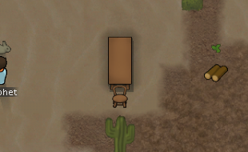
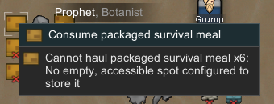
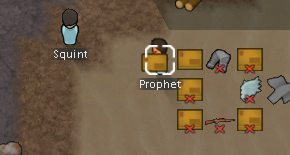
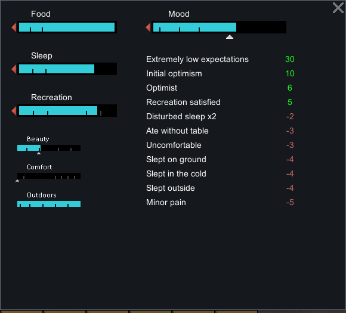
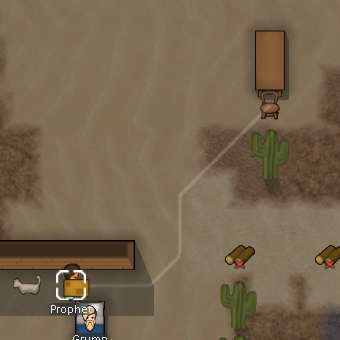
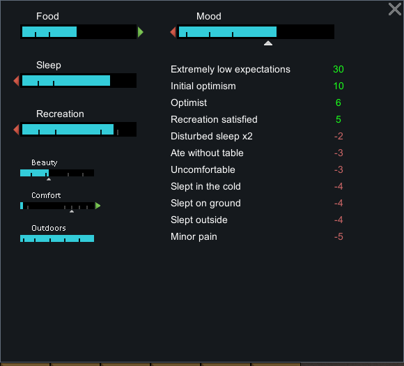
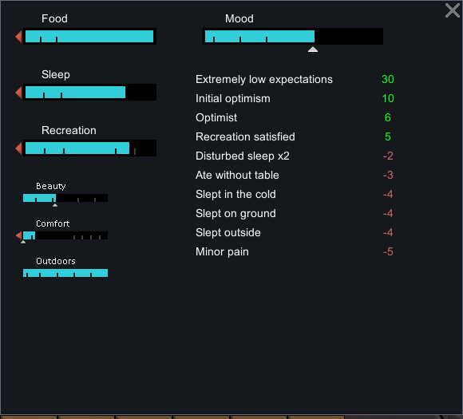

# 95 · 原版进食实机：无桌、预约座位与舒适变化

本轮在 **RimWorld 1.7.4980 rev60 / Core + Odyssey** 的独立配置中完成两条普通进食分支。原版已通过普通 **Quit to OS** 退出，随后 fresh CIM 检查无 RimWorld 进程。没有注入代码、修改程序集或编辑原始存档。

机制解释见 [94 · 餐桌与舒适机制](94-dining-comfort-mechanisms.md)；[运行证据 JSON](evidence/dining-runtime-evidence.json) 保留 8 份原始存档哈希、精确 XML/XPath 投影、61 个成功输入记录以及 8 张相关裁图。

## 准备和普通操作的边界

独立 profile：`.local-research/runtime/profile-dining-20261104`。基线从已完成上一轮研究的 `profile-animal-husbandry-20261104/Saves/New Arrivals3.rws` 复制，两者 SHA-256 同为 `651abba413f1aa854754fa752ca01bba16e23e200fc65ab62b519ea6668ea70f`。只在独立 Prefs 设置 `pauseOnLoad=True`；准备存档仍比基线多 1 tick，不能称零推进。

普通操作包括：选择 Prophet、右键 `Consume packaged survival meal`、运行短模拟片段、观察 Needs、保存、读档与退出。食物来自同一个既有地面堆 `MealSurvivalPack41855`，基线有 6 份；没有开发者生成食物或直接填充需求。

第二分支先普通重载同一基线，再使用 God mode 即时摆放木桌和餐椅，随后关闭 God mode。**家具准备不是普通建造证据**，不能据此判断工时、耗材或品质概率。桌 `Table1x2c149544` 在 `(119,0,132)`，椅 `DiningChair149545` 在 `(119,0,131)`，二者存档品质均为 Normal。



## 原始存档与读档分支

| 原始存档 | ticksGame | 证据用途 |
|---|---:|---|
| dining-baseline | 75812 | 共同基线，Prophet 已有无桌记忆 age 9600、Comfort 0 |
| New Arrivals1 | 76627 | 无桌分支咀嚼中，carry 中仍有 1 份餐食，余 30 tick |
| New Arrivals2 | 76724 | 无桌分支吃完，无桌记忆刷新至 age 150 |
| New Arrivals3 | 75813 | **重载共同基线后**，开发者桌椅准备完成 |
| New Arrivals4 | 76253 | 普通取餐完成，携餐走向已预约的餐椅 |
| New Arrivals5 | 76670 | 真正到达椅格，朝桌咀嚼，Comfort 0.036 |
| New Arrivals6 | 77073 | 吃完，Comfort 0.144，旧无桌记忆 age 10800 |
| New Arrivals7 | 77073 | 相同暂停状态再存，选定对象/预约/需求一致 |

输入动作 22 是第二分支的普通基线读档。因此文件编号不是单调递增的模拟时间线；不能把两条分支拼成一次自然连续游玩，也不把它们当概率统计实验。

## 1. 无桌进食：携带与消费分开

普通右键菜单明确提供 Consume；初始曾打开米饭菜单查看，随后关闭，没有发出吃米饭命令。



在 `New Arrivals1`，Prophet `Human958` 的任务为 `Ingest`、`playerForced=True`，carry 中有 `MealSurvivalPack149545` 1 份，咀嚼 toil 余 30 tick；此时 Food 是 `0.486001104`，无桌记忆 age 为 `10350`。这份餐食已从地面堆拆出并被拿起，尚未在结算阶段消费。



到 `New Arrivals2`，角色转为 `FeedPatient`，Food 变为 `0.994000018`，Comfort 仍为 0，无桌记忆 age 变成 `150`。原先较老记忆变为年轻记忆，证明这次普通无桌进食刷新了记忆。不是仅凭“-3”仍在列表中判断。



## 2. 有桌椅：实际预约和走过去

第二分支从相同基线开始，再次向同一地面餐食堆下达普通 Consume。`New Arrivals4` 中：

```text
tick = 76253
Prophet position = (112, 0, 125)
job = Ingest, playerForced = True
carry = MealSurvivalPack149549 × 1
pather.destination = (119, 0, 131)
reservation.target = Thing_DiningChair149545
destination reservation.target = (119, 0, 131)
reservation claimant = Thing_Human958, job = Job_48525
```

截图中的白线只是路径提示；同档中的椅子预约、目的地预约、carry 对象和寻路终点才建立明确状态证据。



到 `New Arrivals5`，Prophet 真正到达 `(119,0,131)`，pather `moving=False`，`targetB=(119,0,132)`、`rotateToFace=B`，咀嚼还剩 307 tick。食物仍是 carry 中同一 `MealSurvivalPack149549`，Food 仍为 `0.486001104`。


所以这个样本同时证明：存在实际取餐后行走、到达椅格和持续咀嚼；桌面视觉并不意味着把食物从 carry 放进桌子。

## 3. 舒适上升，但旧无桌记忆没有立即消失

基线 Comfort 0，桌边咀嚼档为 `0.0360000022`，完成档为 `0.144000009`。咀嚼中 Needs 显示 Comfort 向上，Food 尚未结算；吃完后 Food 为 `0.994000018`。



完成档仍有 AteWithoutTable，但 age 是 `10800`，继续从基线 9600 老化，没有像无桌分支一样刷新为 150。Needs 中的 Uncomfortable 则消失，因为 Comfort 已跨过 0.1；旧无桌记忆仍保留。这两项心情来源彼此独立。



两次完成采样后的 Food 数值相同，不代表进食过程/耗时相同，也不用于拟合精确的即时营养增量；需求和 memory 年龄有采样/批次更新时间差，本轮只记录存档原值。没有测餐厅 Impressiveness 加成或舒适长期平衡。

## 完整性、限制与复核

最后两档均为 tick 77073，选定 pawn、需求、记忆、桌椅、食物堆及预约投影一致；没有宣称整份存档字节相同。61 条成功动作各有全屏原图和独立动作日志；第 62 次退出点击后进程退出，截图前台检查失败，因此没有虚构成功 action 62 或退出图。

启动命令保留于任务工具历史，但本轮没有另外捕获同时刻 launch-record JSON 或启动前 Prefs 哈希；证据明确保留这一限制。全部原始存档和全屏图保留在本地 `.local-research`，公开仅为必要节点投影、哈希和裁图。

未实测：同时抢座、无椅仅桌、禁用/燃烧/被占座位、征召时进食、途中中断、远桌半径边界、餐厅加成、家具正常建造和品质产生。这些不能写成已验证；静态规则见 94。Web 的参数/行为简化见 [96 · 生活与就餐玩法](96-living-dining-gameplay.md)，原版观察不等于 Web 数值校准。

```powershell
node scripts/research/verify-dining-comfort-evidence.mjs
node scripts/research/verify-dining-comfort-evidence.mjs --local
```

[UI 输入工具](../../../scripts/research/dining-runtime-input.ps1) 只向指定隔离进程发送键鼠；[采集器](../../../scripts/research/collect-native-dining-runtime.ps1) 和 [验证器](../../../scripts/research/verify-dining-comfort-evidence.mjs) 只读保存的证据，不启动原版、不重放输入、不校准概率。
