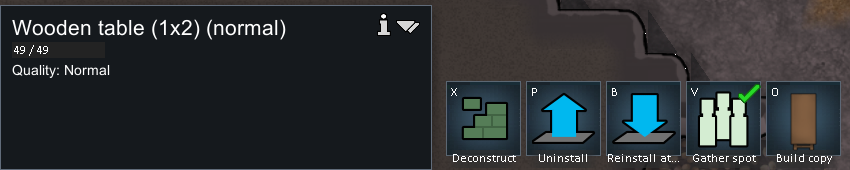
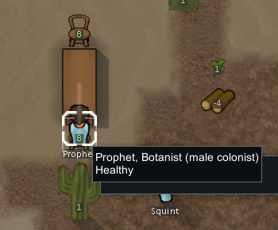
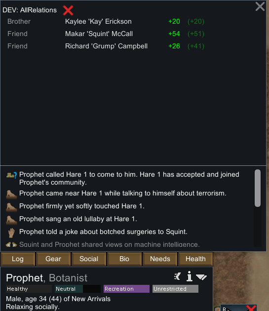
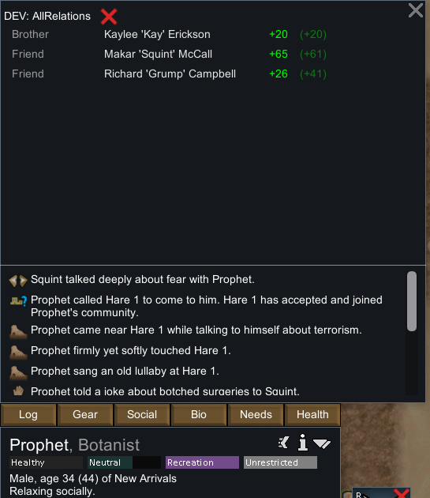
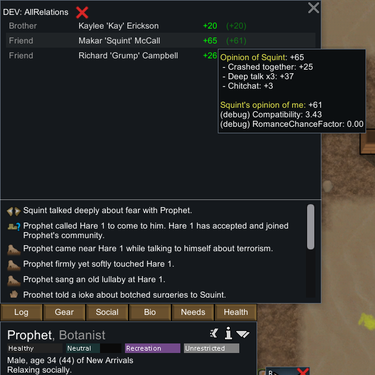
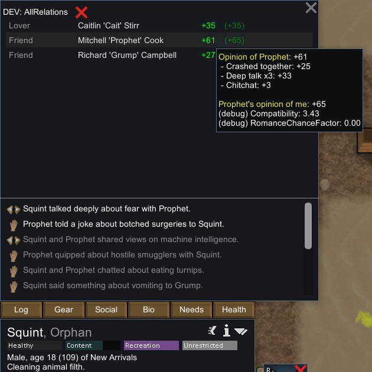

# 原版自动深入交谈与桌边休闲观察

2026-11-04，RimWorld **1.7.4980 rev60**，Core+Odyssey，隔离 profile `profile-social-20261104`。本轮观察到一条新 **Squint → Prophet / DeepTalk**，记录双方身份、记忆、互动日志、意见 UI，以及原有 SocialRelax 任务持续状态。原始完整存档/全屏图留本地，公开 [运行证据](evidence/social-runtime-evidence.json) 内含精确 XPath 投影、哈希、52 条成功操作与 6 张裁图。静态机制见 [97](97-social-interaction-mechanisms.md)。

## 准备与普通运行分开

基线从上一轮 [原版用餐观察](95-native-dining-runtime.md) 最终 `New Arrivals7.rws` 复制，SHA-256 `3fa11ef70c63bb35453b2044dcda3e6e9a41c50b1c90c017e48e95baad7ad25b`，game tick 77073。启动前已记录基线、Prefs、ModsConfig 哈希和启动时间/PID；本轮未编辑任何 `.rws`。

开发者准备只在原版 God 模式复制一把木椅，放在既有餐桌另一端 `(119,0,134)`，随后关闭 God。原有椅位为 `(119,0,131)`。普通排班涂抹 Recreation 时，12 步鼠标拖动实际涂成部分交错小时，**没有成功改成全天娱乐**；原档 timetable 留存，当前 13h 为 Recreation。一次 debug 搜索 need 没有匹配操作；未改需求、未调用 Force interaction 或 Try Joy Giver。

不把开发瞬造椅子的成本、耗时或品质当成实测，也不把原档已有的 Chitchat/DeepTalk 当成本轮发生。

## 连续原档与关键事件

| 原档 | tick | 作用 |
| --- | ---: | --- |
| social-baseline | 77073 | 既有家具、人物与社交记忆 |
| New Arrivals1 | 77074 | 新椅与普通排班已准备；无新互动日志 |
| New Arrivals2 | 78429 | Prophet 已自动 SocialRelax；事件前态 |
| New Arrivals3 | 79055 | 新 DeepTalk 已发生；事件后态 |
| New Arrivals4 | 79055 | 暂停下重复保存，所选状态一致 |

事件前，Prophet=`Human958`，坐在 `(119,0,131)`；Job `SocialRelax`，loadID **48947**，targetA 是 `Table1x2c149544`，targetB 为该实际席位，toil=1，剩余3978 tick。预约记录明确为 `Human958 / Job_48947 / DiningChair149545 / maxPawns=1`。该 Job 来自 Humanlike think tree，未标 playerForced。Squint=`Human961` 位于 `(122,0,129)`，当时 GotoWander，已有 wantsRandomInteract。第三人 Grump 躺床受伤，本轮未用他代替正常互动接收者。

普通加速脉冲后，新增 PlayLog **logID=24**，`intDef=DeepTalk`、initiator=`Thing_Human961`、recipient=`Thing_Human958`，`ticksAbs=148450`；双方 tracker 的 `lastInteractionTime=78450`。绝对 tick 与 game tick 相差 70000，不能直接混为同一时间轴。前档日志共23条，后档24条，只有这一次新增互动。

## 双向记忆与意见

| 数据 | Prophet 对 Squint | Squint 对 Prophet |
| --- | ---: | ---: |
| 事件前该对 DeepTalk 条数 | 2 | 2 |
| 事件后条数 | 3 | 3 |
| 新记忆 age | 600 | 600 |
| 新记忆 opinionOffset | 13.5374994 | 12.3000002 |
| 新记忆 moodPowerFactor | 0.902499974 | 0.819999993 |
| UI 意见前→后 | 54→65 | 51→61 |

新记忆数值等于基础15乘**对方**的 SocialImpact，不是双方都固定+15。后态意见 tooltip 显示共同坠落+25、DeepTalk×3分别+37/+33、Chitchat各+3；25+37+3=65，25+33+3=61。第三条加入后旧条目的叠加权重也重新排序，所以最终整数增量是+11/+10。

UI 的 DEV 标签与额外 compatibility 数值来自已开启的开发显示，不能据此说本次事件是开发指令触发。全部输入记录中没有指定互动类型或双方的操作。compatibility=3.43 是这两名已有角色的显示值，不能外推随机新殖民者的分布。

## 互动没有替换桌边休闲任务

Prophet 在前后两档保持同一 SocialRelax **48947**、toil1、同一椅位，剩余 tick 从3978降至3352，恰为626 tick；joy 从0.797087073升至0.88470453，comfort 从0.12240003升至0.266400039。Squint 后态已去 Clean，既未占第二把椅，也未停在一项长对话任务中。

这组证据支持“普通互动事件与持续娱乐任务分开”。它**不证明由 Prophet 的 SuperActive 发起了这一次交谈**：实际 initiator 是已请求随机互动的 Squint。也不把截图采样位置当作事件发生那一 tick 的精确距离。一次互动的概率、MTB、视线边界均不作统计拟合。

## 关闭与边界

最终两档在79055的所选人物、记忆、日志、家具和预约节点一致。通过普通 Quit to OS 退出；退出点击后的截图已无法获得前台进程，未伪造成功 action53 或退出图。随后新一次 CIM 查询确认无 RimWorld/RimWorldWin64 进程；独立 shutdown-record 留存。

本轮新观察只有 DeepTalk，没有新 Chitchat/Insult、社交打架、完整4000 tick结束、同时双人坐席、关闭聚集开关、无椅回退或中断分支。也未观察瞬时气泡图像；对话发生证据为新日志、双方新记忆及前后 UI。普通重复保存验证所选状态，未冒称已经再次加载验证。

[原版输入脚本](../../../scripts/research/social-runtime-input.ps1) 仅校验隔离 profile/进程/前台后发键鼠；[采集器](../../../scripts/research/collect-native-social-runtime.ps1) 仅读取存档与裁图；[校验器](../../../scripts/research/verify-social-interaction-evidence.mjs) 支持 portable 和 `--local`。
